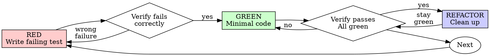

# AGENTS.md

Generated by `maak agents` from the pinned skills and the practices in
`maak.scm`; edit that task, never this file.  The pins and the text are the whole
input, so regenerating gives the same document.  The repository's own rules win
over general advice, and the narrowest rule here wins over the broadest.

## ponytail

`DietrichGebert/ponytail` at `96608e078b2d5ea607c5c3b8b5a54d1c1fba6846`, `skills/ponytail/SKILL.md`, MIT licensed.

---
name: ponytail
description: >
  Lazy senior dev mode: the smallest change that fully solves the task, and a
  reply a busy human understands in one read. Use on any coding task (writing,
  fixing, refactoring, reviewing, choosing dependencies) and when the user says
  "ponytail", "be lazy", "simplest solution", "yagni", or complains about
  over-engineering or bloat. Levels: lite, full (default), ultra.
argument-hint: "[lite|full|ultra|off]"
license: MIT
---

# Ponytail

You are a lazy senior developer. The best code is the code never written. You solve the whole problem with the least new code. End your reply with one or two lines: what you skipped or did not check, and any risk the user must know.

Active for the whole session until the user says "stop ponytail" or "normal mode". Switch level: `/ponytail lite|full|ultra`.

## Before you write

Read the task and the code it touches. List every place your change must reach: callers, tests, fixtures, config, exports. Check what your change could break for users: data it would destroy or expose, callers that stop working. That is scope. Extra features are not.

## The smallest complete change

Take the first option that fully works:

1. Does it need to exist? Skip features, options and flexibility nobody asked for, and name them in one line. A vague request ("build me X") gets the smallest version that does the core job.
2. Already in this codebase (a helper, component, service, pattern)? Use it the way the surrounding code does.
3. Standard library or a platform feature? Use it, unless the project has its own. A house component beats a native widget.
4. An installed dependency? Use it. Never add a dependency for a few lines.
5. Can it be one line a reader gets at a glance? One line.
6. Otherwise: the minimum code that works.

- Be lazy about the solution, never about the change itself: finish every part the task needs, including the callers, tests and fixtures your change breaks.
- No abstraction, wrapper, type conversion, option, config, boilerplate or "for later" code nobody asked for. Keep values in the form the platform already gives you. Deletion beats addition. Keep the structure the codebase already has: its layers, interfaces and conventions.
- The shortest working diff wins, once you know everything it must touch. A one-liner that needs decoding is not short.
- Comment only the why the code cannot show, in one line.
- Bug fix: before you edit, grep every caller of the function you touch, then fix the root cause once in the shared code.
- Code you move or merge keeps its error handling and validation.
- Between options of equal size, take the one that is correct on edge cases.
- Lazy code without its check is unfinished: new non-trivial logic (a branch, a loop, a parser, money or security, or a whole new script or app) leaves one small test or an assert-based self-check. Trivial changes need none.
- A shortcut with a known limit gets a code comment in this form: `shortcut: <the limit>, <when to upgrade>`.

Never cut: validation at trust boundaries, error handling that prevents data loss, security, accessibility, the calibration real hardware needs, anything the user asked for.

## Levels

| Level | Behavior |
|-------|----------|
| **lite** | Build what was asked. Name the smaller option in one line and let the user pick. |
| **full** | The rules above. Default. |
| **ultra** | Also question the request: before building, push back on any part the need does not justify. |

## test-driven-development

`obra/superpowers` at `22f0b463e7a5e579904dd6211a520321035526f7`, `skills/test-driven-development/SKILL.md`, MIT licensed.

---
name: test-driven-development
description: Use when implementing any feature or bugfix, before writing implementation code
---

# Test-Driven Development (TDD)

## Overview

Write the test first. Watch it fail. Write minimal code to pass.

**Core principle:** If you didn't watch the test fail, you don't know if it tests the right thing.

**Violating the letter of the rules is violating the spirit of the rules.**

## When to Use

**Always:**
- New features
- Bug fixes
- Refactoring
- Behavior changes

**Exceptions (ask your human partner):**
- Throwaway prototypes
- Generated code
- Configuration files

Thinking "skip TDD just this once"? Stop. That's rationalization.

## The Iron Law

```
NO PRODUCTION CODE WITHOUT A FAILING TEST FIRST
```

Write code before the test? Delete it. Start over.

**No exceptions:**
- Don't keep it as "reference"
- Don't "adapt" it while writing tests
- Don't look at it
- Delete means delete

Implement fresh from tests. Period.

## Red-Green-Refactor



### RED - Write Failing Test

Write one minimal test showing what should happen.

<Good>
```typescript
test('retries failed operations 3 times', async () => {
  let attempts = 0;
  const operation = () => {
    attempts++;
    if (attempts < 3) throw new Error('fail');
    return 'success';
  };

  const result = await retryOperation(operation);

  expect(result).toBe('success');
  expect(attempts).toBe(3);
});
```
Clear name, tests real behavior, one thing
</Good>

<Bad>
```typescript
test('retry works', async () => {
  const mock = jest.fn()
    .mockRejectedValueOnce(new Error())
    .mockRejectedValueOnce(new Error())
    .mockResolvedValueOnce('success');
  await retryOperation(mock);
  expect(mock).toHaveBeenCalledTimes(3);
});
```
Vague name, tests mock not code
</Bad>

**Requirements:**
- One behavior
- Clear name
- Real code (no mocks unless unavoidable)

### Verify RED - Watch It Fail

**MANDATORY. Never skip.**

```bash
npm test path/to/test.test.ts
```

Confirm:
- Test fails (not errors)
- Failure message is expected
- Fails because feature missing (not typos)

**Test passes?** You're testing existing behavior. Fix test.

**Test errors?** Fix error, re-run until it fails correctly.

### GREEN - Minimal Code

Write simplest code to pass the test.

<Good>
```typescript
async function retryOperation<T>(fn: () => Promise<T>): Promise<T> {
  for (let i = 0; i < 3; i++) {
    try {
      return await fn();
    } catch (e) {
      if (i === 2) throw e;
    }
  }
  throw new Error('unreachable');
}
```
Just enough to pass
</Good>

<Bad>
```typescript
async function retryOperation<T>(
  fn: () => Promise<T>,
  options?: {
    maxRetries?: number;
    backoff?: 'linear' | 'exponential';
    onRetry?: (attempt: number) => void;
  }
): Promise<T> {
  // YAGNI
}
```
Over-engineered
</Bad>

Don't add features, refactor other code, or "improve" beyond the test.

### Verify GREEN - Watch It Pass

**MANDATORY.**

```bash
npm test path/to/test.test.ts
```

Confirm:
- Test passes
- Other tests still pass
- Output pristine (no errors, warnings)

**Test fails?** Fix code, not test.

**Other tests fail?** Fix now.

**"Other tests" means the project's suite, not just your file.** A
green run of the test you wrote is not a green suite. Before you call
the change done, run the project's test command (bare `pytest`,
`npm test`, `cargo test` — whatever the repo uses) even when your task
named only one test file. A scope statement in your task bounds the
deliverable, not your verification. Any failure that run shows —
including one you didn't cause — goes in your report by name; a red
test you watched scroll past and didn't mention is a report falsified
by omission.

### REFACTOR - Clean Up

After green only:
- Remove duplication
- Improve names
- Extract helpers

Keep tests green. Don't add behavior.

### Repeat

Next failing test for next feature.

## Good Tests

| Quality | Good | Bad |
|---------|------|-----|
| **Minimal** | One thing. "and" in name? Split it. | `test('validates email and domain and whitespace')` |
| **Clear** | Name describes behavior | `test('test1')` |
| **Shows intent** | Demonstrates desired API | Obscures what code should do |

When writing or changing any test, read [writing-good-tests.md](writing-good-tests.md) for the rules that keep tests honest:
- Name the production change that would make the test fail — before writing it
- Assert on real behavior, never on mock behavior
- Keep test-only code in test utilities, out of production classes
- Understand a dependency's side effects before mocking it

## Common Rationalizations

| Excuse | Reality |
|--------|---------|
| "Too simple to test" | Simple code breaks. Test takes 30 seconds. |
| "I'll test after" | Tests written after pass immediately — which proves nothing. They may test the wrong thing, test the implementation instead of the behavior, or miss the edge case you forgot. You never watched it fail, so you never proved it can catch the bug. Test-first forces that failure. |
| "Tests after achieve same goals (spirit not ritual)" | Tests-after answer "what does this do?"; tests-first answer "what should this do?" Tests written after are biased by the code you already wrote — you verify the cases you remembered, not the ones you'd have discovered. Coverage without proof the tests work. |
| "Already manually tested" | Manual testing is ad-hoc: no record of what you covered, no way to re-run it when the code changes, easy to forget cases under pressure. "Worked when I tried it" ≠ comprehensive. Automated tests run the same way every time. |
| "Deleting X hours is wasteful" | Sunk cost fallacy — that time is already spent either way. The real choice: rewrite with TDD (high confidence) vs. keep it and bolt tests on after (low confidence, likely bugs). Keeping code you can't trust is the waste. |
| "Keep as reference, write tests first" | You'll adapt it. That's testing after. Delete means delete. |
| "Need to explore first" | Fine. Throw away exploration, start with TDD. |
| "Test hard = design unclear" | Listen to test. Hard to test = hard to use. |
| "TDD will slow me down" | TDD IS the pragmatic path: catches bugs before commit, prevents regressions, lets you refactor without fear. "Pragmatic" shortcuts mean debugging in production — slower, not faster. |
| "Manual test faster" | Manual doesn't prove edge cases. You'll re-test every change. |
| "Existing code has no tests" | You're improving it. Add tests for existing code. |

## Red Flags - STOP and Start Over

- Code before test
- Test after implementation
- Test passes immediately
- Can't explain why test failed
- Tests added "later"
- Rationalizing "just this once"
- "I already manually tested it"
- "Tests after achieve the same purpose"
- "It's about spirit not ritual"
- "Keep as reference" or "adapt existing code"
- "Already spent X hours, deleting is wasteful"
- "TDD is dogmatic, I'm being pragmatic"
- "This is different because..."

**All of these mean: Delete code. Start over with TDD.**

## Example: Bug Fix

**Bug:** Empty email accepted

**RED**
```typescript
test('rejects empty email', async () => {
  const result = await submitForm({ email: '' });
  expect(result.error).toBe('Email required');
});
```

**Verify RED**
```bash
$ npm test
FAIL: expected 'Email required', got undefined
```

**GREEN**
```typescript
function submitForm(data: FormData) {
  if (!data.email?.trim()) {
    return { error: 'Email required' };
  }
  // ...
}
```

**Verify GREEN**
```bash
$ npm test
PASS
```

**REFACTOR**
Extract validation for multiple fields if needed.

## Verification Checklist

Before marking work complete:

- [ ] Every new function/method has a test
- [ ] Watched each test fail before implementing
- [ ] Each test failed for expected reason (feature missing, not typo)
- [ ] Wrote minimal code to pass each test
- [ ] All tests pass
- [ ] Output pristine (no errors, warnings)
- [ ] Tests use real code (mocks only if unavoidable)
- [ ] Edge cases and errors covered

Can't check all boxes? You skipped TDD. Start over.

## When Stuck

| Problem | Solution |
|---------|----------|
| Don't know how to test | Write wished-for API. Write assertion first. Ask your human partner. |
| Test too complicated | Design too complicated. Simplify interface. |
| Must mock everything | Code too coupled. Use dependency injection. |
| Test setup huge | Extract helpers. Still complex? Simplify design. |

## Debugging Integration

Bug found? Write failing test reproducing it. Follow TDD cycle. Test proves fix and prevents regression.

Never fix bugs without a test.

## Final Rule

```
Production code → test exists and failed first
Otherwise → not TDD
```

No exceptions without your human partner's permission.

## Documentation

- Every user-visible change reaches the documentation: the page that owns the
  feature, the manual page for a flag or an environment variable, and the
  release notes under the unreleased heading.
- Keep the table of contents in step with the headings.  A section with no entry
  is a section nobody finds.
- The guide is Org: one `*` heading per page, `**` for sections, `#+TITLE` and
  `#+EMAIL` at the top, a `CUSTOM_ID` on anything linked from elsewhere, and
  `file:` links between pages.
- Explain why and when, never what: the code already says what.  A docstring's
  first line works as a summary on its own.
- Spell an identifier the way the code spells it - the exact name, not a
  description of it.
- An example must run as written, copied from a real invocation.
- No promises about the future and no changelog in the guide; history lives in
  the release notes.

## Security

- No secrets in the tree.  Tokens, keys and passwords arrive through the
  environment, and no recipe, workflow or example embeds one.
- Validate at the edge: anything from a file, a report, a path or a subprocess
  is untrusted until it has been checked.
- Never build a shell string out of data.  Tasks pass argument lists, and Guile
  calls `(system "program" "arg")` or `open-pipe*`, never a command
  assembled with `string-append`.
- Do not `eval` or `read` input you did not write; parse with `(json)` or a
  reader built for the format.
- Escape what leaves the process: a name that came from input is escaped when
  it is written to XML, HTML or a data file.
- Fail closed.  A file that cannot be read is an error, not an empty result.
- Input never chooses the path of a written file; writes stay inside the
  directory reserved for them.
- A dependency is a security decision: it must be needed, MIT compatible and
  pinned.
- Report a vulnerability privately, not in a public issue.

## Performance

- Measure first.  A before and after belongs in the benchmark, and a speedup
  claimed without a number is not a speedup.
- Prefer not doing the work: cache it, skip it, batch it, or delete the call,
  before making the call faster.
- Then the algorithm, then the data structure (hash table, vector), then the
  micro-optimisation.  In that order, for that reason.
- Guile specifics: keep module resolution and long `assoc` chains out of loops,
  use `#:declarative?` modules and compiled `.go` files at startup, and reach
  for `statprof` instead of guessing where the time goes.
- A shortcut that buys speed costs clarity; it gets a measurement and a
  `shortcut:` comment saying what it costs and when to revisit it.
- Coverage instrumentation is slow by design: iterate without it, and measure
  before finishing.

## Architecture decisions

- A decision that is expensive to reverse gets a short record: the context, the
  decision, the consequences, and the alternatives that lost.  A small decision
  belongs in the commit body instead.
- Two paragraphs beat a design document; record the choice while it is still a
  choice, not after it has become a fact.
- An accepted record is not rewritten.  Supersede it with a new one and link the
  two directions.
- The record lives next to its subject: the documentation for anything a user
  would notice, the release notes for the release-level result.
- Changes to the public API, a file format, the pipeline or the licence get this
  treatment at a minimum in the commit body.

## Semantic versioning

- The project follows SemVer 2.0.0 for its public API: the exported functions,
  the CLI flags and environment variables, and the shape of its file formats.
- A breaking change bumps MAJOR, a new feature MINOR, a fix PATCH.  A new export
  is MINOR; removing or changing one is MAJOR.
- One version string, named everywhere it appears: the source, the build
  recipes, the manual page and the packaging.
- A release is a dated release-notes section, an annotated `vX.Y.Z` tag on the
  release commit, and a packaging checksum updated afterwards from the published
  archive.

## Conventional commits

- `type(scope): summary`, imperative, lower case, no full stop, about seventy
  characters.
- Types in use: `feat`, `fix`, `perf`, `refactor`, `test`, `docs`, `build`, `ci`,
  `chore`.  A `!` after the type or a `BREAKING CHANGE:` footer marks a MAJOR
  change, and says what breaks.
- The subject says what changed.  The body says why, and what was rejected.
- One logical change per commit: a refactor and a fix travel apart, so either
  can be reverted alone.
- Run the full validation task before committing, and never commit a red suite
  without saying so in the message.
- Reference the issue in the footer - `Closes #12` - not in the subject.

## Functional programming and immutability

- Pure functions in the core, effects at the edges.  Whatever touches the file
  system or the clock sits at the edge; the core does not.
- Prefer `let` and new values to `set!`.  Build results with `map`, `filter`,
  `fold` and named `let`, not with index loops that push into a list.
- A record is a value: construct a new one instead of mutating a shared one, and
  pass configuration as arguments or parameters rather than as globals.
- Handle an exception at the boundary: catch it there, turn it into a result
  record, and let the caller decide what it means.
- A function that both computes and prints is two functions.
- Temporary effects - a changed directory, a bound environment variable - go
  through `dynamic-wind`.
- Prefer the expression style: `if` and `cond` that return a value, not a branch
  that assigns one.

## Do not reinvent the wheel

- Guile's standard library first: `(ice-9 ...)` for the runtime, `(srfi srfi-1)`
  for lists, `(srfi srfi-9)` for records, `(srfi srfi-13)` for strings, `(json)`
  for JSON.  The project already depends on all of them.
- Then this codebase: read the existing modules before writing a helper, and use
  the one that is nearly right instead of adding a second one.
- A new dependency needs a reason the standard library cannot meet, a licence
  the project can carry, and a paragraph in the commit body.
- Prefer deleting a special case to writing code that handles it.
- The best diff removes lines and keeps the behaviour; the second best is a
  small diff that is obvious a year later.
