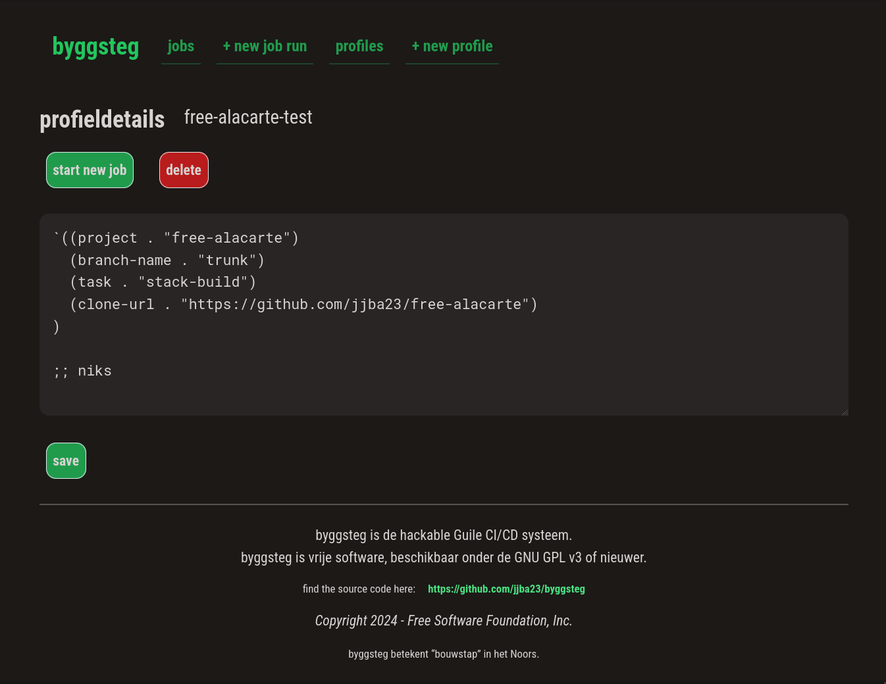

#+title: byggsteg
#+options: toc:nil num:nil

/byggsteg/ means "build step" in the Norwegian language.

This is a simple CI/CD system written in Guile Scheme.

byggsteg uses plain Guile, SXML, and some basic POSIX / UNIX utilities.

It is built with the mighty GNU Artanis web-framework.

** What is byggsteg ?

byggsteg is a free software project with the aim of developing a suite of functionalities to allow engineers to deliver software quicker and with less friction.

The aim of byggsteg is to release you from your dependency on proprietary systems like GitHub actions.
This allows you to create continuous integration and continuous delivery (CI & CD) pipelines in an easy way that are tailored to your needs and which you fully control.

My initial idea when developing byggsteg revolves around my Haskell projects, which are hosted on Codeberg and deployed to my private VPS.

I don't mind having the software building and testing happening in the same machine as where I run the production workloads, since I am looking for supreme cost-efficiency, but it's highly recommended that you do separate these things, if you can afford it.

And thus, I set out to build a CI/CD system, that on command can:
- clone specified repo URL to an isolated folder for each branch (but caching by reusing same branch and doing ~git pull~)
- navigate to that directory and perform a system command a.k.a. job (for a Haskell project ~stack test~ or ~stack build~ or a combination of those)
- capture the log output of all steps and save it
- record job in progress, success or failure
- show dashboard with job statuses

byggsteg is a deploy-your-own type tool, but if enough community interest is shown a SaaS offering in freedom might be a really good thing.

byggsteg is built using the GNU Artanis web-framework. Make sure you install it before you proceed with using byggsteg.

Refer to the Artanis documentation: [[https://www.gnu.org/software/artanis/manual/manual.html][here]] .

** Types of jobs

~stack-test~ - Haskell project build and test with Stack + Hackage bundle

~stack-build~ - Haskell project build with Stack + Hackage bundle

~nix-build~ - Nix build (flake)

~byggsteg-version~ - Byggsteg pull and restart shepherd daemon itself

~pull-and-restart~ - Git pull and restart wanted shepherd service

~sbt-test~ - Scala project test with SBT

** Starting a job

Jobs and profiles are simple Guile Scheme code. byggsteg allows you to send code over the wire (HTTP) and save it too, for example :
#+begin_src  scheme
  `((project . "free-alacarte")
    (branch-name . "trunk")
    (task . "stack-test")
    (clone-url . "https://codeberg.org/jjba23/free-alacarte")
    )
#+end_src

You can use the UI and visit ~/jobs/request~ or you can also invoke this via the REST API via Guile Scheme in URL encoded form data (~application/x-www-form-urlencoded~).

You could do this  for example from your favourite system programatically, or via cURL:

#+begin_src sh
curl 'https://byggsteg.jointhefreeworld.org/api/v1/jobs/manage/submit' \
    -X POST -H 'Content-Type: application/x-www-form-urlencoded' \
    -H 'Authorization: Basic ${{secrets.BYGGSTEG_KEY}}' \
    --data-urlencode 'job-code=`((project . "free-alacarte")(branch-name . "trunk")(task . "stack-test")(clone-url . "https://codeberg.org/jjba23/free-alacarte"))'
  
#  {
#    "log-filename": "667265652d616c6163"
#  }
#+end_src

You can query for the job status via the UI or also via the REST API. You could implement a check to keep querying for job status until succeess or failure is true.

#+begin_src  shell
  curl 'http://localhost:3000/api/v1/logs/667265652d616c6163'
  #
  # {"success": true,
  #  "failure": false,
  #  "in-progress": false,
  #  "log-filename": "free-alacarte__2024-09-28__15:21:07.byggsteg.log",
  #  "log-data": "31353a32313a30372e627......."
  # }
#+end_src

** Using

You can run byggsteg server by calling ~art work~ from the root directory. Refer to the ~Makefile~ for more convenient commands and variations.

byggsteg exposes an HTML frontend (server-side-rendered SSR) and a REST API, and should be compatible with most UNIX like systems, but is best experiences with GNU Guix.

An example shepherd service for byggsteg could look like this:
#+begin_src scheme
  (use-modules (gnu)
               (gnu services shepherd))

  ;; ...............

  (define (byggsteg-service config)
    (list
     (shepherd-service
      (documentation "Run byggsteg as a daemon")
      (provision '(byggsteg))
      (requirement '())
      (start #~(make-forkexec-constructor
                '("make" "server")
                #:directory "/var/log/byggsteg/job-clone/byggsteg/trunk"
                #:environment-variables
                (list
                 "PATH=/run/privileged/bin:/run/current-system/profile/bin:/run/current-system/profile/sbin"
                 "LANG=nl_NL.UTF-8")))
      (stop #~(make-kill-destructor))
      (auto-start? #t)
      (respawn? #t)
      )))

  (define byggsteg-service-type
    (service-type
     (name 'byggsteg)
     (description "Run byggsteg as a daemon")
     (extensions
      (list (service-extension
             shepherd-root-service-type
             byggsteg-service)))
     (default-value '())
     ))

  ;; then load it with (service byggsteg-service-type)
#+end_src

** Licensing

byggsteg is licensed under the GNU GPL v3 License or newer.

** Code owners

The project's main branch is ~trunk~. Find a list of roles and people involved in the project.

*** BDFL (Benevolent Dictator For Life)
@jjba23 - Josep Bigorra <jjbigorra@gmail.com>

Only BDFL can merge PRs.
Only BDFL is allowed to push directly to ~trunk~ in case a quick fix is needed.

*** MFL (Maintainer For Life)
@NalaGinrut - Roy Mu <NalaGinrut@hardenedlinux.org>

MFL can ascend to BDFL after extensive productive collaboration.
MFL has write permissions to all branches (except trunk) and can open PRs.

*** Other contributors
Other contributors must fork byggsteg and create a pull request to contribute back.
After productive collaboration other kinds of roles can be added and assigned.

** Ongoing efforts

**** WIP Feature parity (cleanup HTML and bring all functionalities to REST JSON)

** Project backlog

**** TODO Move to using base64 for URLs and payloads instead of base16

**** TODO Hot reload server

**** TODO Add REPL interface via website, to allow hot-modifications

** ✅ Work done

**** DONE Allow user to send Guile Scheme over the wire and define his/her own pipeline in a ~progn~ fashion.
CLOSED: [2024-10-03 do 13:24]

**** DONE Concurrency primitives and usage
CLOSED: [2024-10-01 di 00:23]

**** DONE Split codebase into separate modules
CLOSED: [2024-09-28 za 12:17]

**** DONE Implement basic internationalization
CLOSED: [2024-10-05 za 14:34]

**** DONE Migration to GNU Artanis
CLOSED: [2024-12-02 ma 14:24]

**** DONE Improve JSON support
CLOSED: [2024-12-02 ma 17:07]
