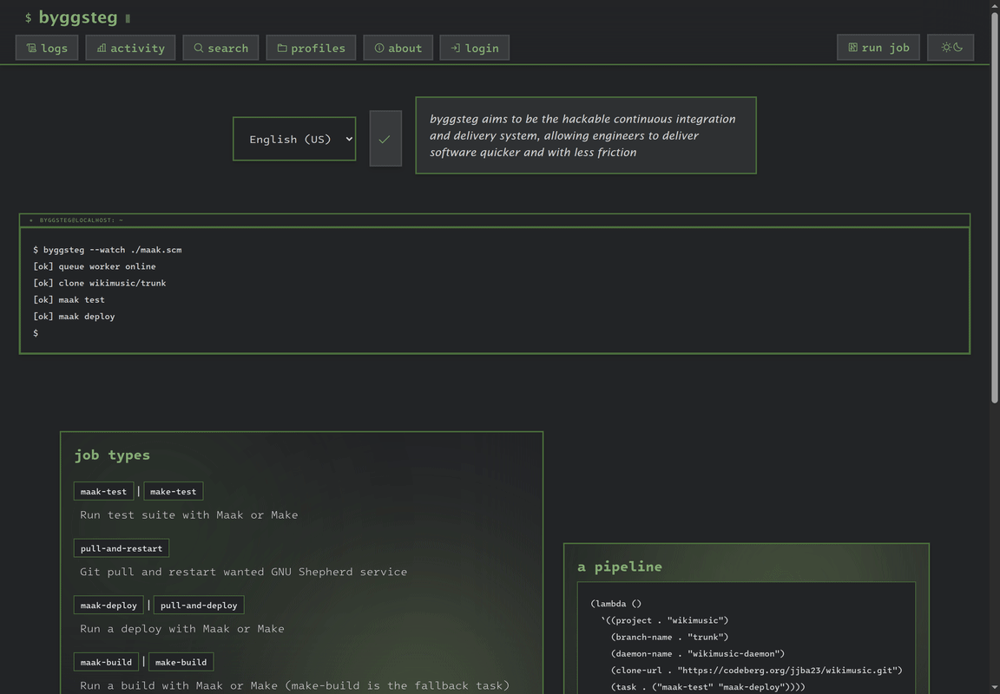

#+title: byggsteg
#+subtitle: the CI/CD orchestrator you can read, run and replace
#+author: Josep Bigorra
#+email: jjbigorra@gmail.com
#+language: en
#+options: toc:nil num:nil html-style:nil
#+HTML_HEAD: <link rel="stylesheet" type="text/css" href="https://jointhefreeworld.org/static/css/jointhefreeworld.css" />

[[https://jointhefreeworld.org/ggg/dist/byggsteg.svg]] [[https://jointhefreeworld.org/ggg/dist/scheme-guile.svg]] [[https://jointhefreeworld.org/ggg/dist/gnu-guix.svg]] [[https://jointhefreeworld.org/ggg/dist/hygguile.svg]]
[[https://jointhefreeworld.org/ggg/dist/license-agpl3+.svg]] [[https://jointhefreeworld.org/ggg/dist/license-fdl13+.svg]] [[https://jointhefreeworld.org/ggg/dist/maak.svg]] [[https://jointhefreeworld.org/ggg/dist/gnu-artanis.svg]] [[https://jointhefreeworld.org/ggg/dist/i18n-gnu-gettext.svg]] [[https://jointhefreeworld.org/ggg/dist/jointhefreeworld-org.svg]]

/a build step, in Lisp: describe your pipeline as a list, and byggsteg runs it/

byggsteg is a continuous integration and delivery system written in Scheme (GNU
Guile).  You hand it Lisp, it clones a repository, runs the steps that Lisp asks
for, streams what they print while they are printing it, keeps what they built,
and tells you how it went.  It is small enough to read in an afternoon and yours
to hack -- on your own machine, under your own licence, with no account anywhere
else.

#+name: byggsteg-showcase
#+caption: The console in its dark theme and in the order a reader meets it: the landing page and the job types a pipeline can ask for, the runs a deployment has behind it, one of those runs opened on its log, on the output as it arrived and on the Lisp that asked for it, a year of runs week by week, a search across jobs, logs and profiles, the saved profiles and one of them, the account of what this is, the way in, and the landing page again, where the tour began.
[[https://codeberg.org/jjba23/byggsteg/raw/branch/trunk/pub/byggsteg-showcase.gif]]

- 🌍 *Watch it run:* [[https://byggsteg.jointhefreeworld.org][byggsteg.jointhefreeworld.org]]
- 📖 *Read this document rendered as HTML:* [[https://jointhefreeworld.org/manuals/byggsteg/][the byggsteg manual]]
- 💾 *Read the source (and send PR/issue/patches):* [[https://codeberg.org/jjba23/byggsteg][codeberg.org/jjba23/byggsteg]]
- 🗺️ *Follow what is next:* [[https://lucidplan.jointhefreeworld.org/tickets/byggsteg][the byggsteg board]]

If you like my work, please support me by [[https://bmc.link/jjbigorra][buying me a cup of coffee ☕]] so I can continue with a lot of motivation.

#+TOC: headlines 1

This is both the project's README and its manual: one document, so that a reader
has one place to look and the two cannot come to say different things.
/byggsteg/ is the Norwegian word for a *build step*.

------------------

* What byggsteg is

byggsteg is a free software project with the aim of developing a suite of
functionalities to allow engineers to deliver software quicker and with less
friction.

Its aim is to release you from your dependency on proprietary systems like
GitHub Actions.  This allows you to create continuous integration and continuous
delivery (CI & CD) pipelines in an easy way that are tailored to your needs and
which you fully control -- easily deployed to your private VPS, to your own
self-hosting, or to a cloud of your choosing.

[[https://jointhefreeworld.org/static-assets/byggsteg/logo-small.png]]

View a live instance of byggsteg here: https://byggsteg.jointhefreeworld.org

I don't mind having the software building and testing happening in the same
machine as where I run the production workloads, since I am looking for supreme
cost-efficiency, but it's highly recommended that you do separate these things,
if you can afford it.

byggsteg enhances the use of Agile work methodologies in teams due to its
fast-paced no nonsense workflows and its customizability, also thanks to being
written in Lisp (GNU Guile Scheme).

** Who it is for

- *Small teams that want their own CI.*  One machine, one process, one database,
  and pipelines that are a page of Scheme instead of a page of someone else's
  YAML dialect.
- *One-person projects and hobby deployments.*  Supreme cost-efficiency: the
  same box can build the software and run it, and six months of runs cost one
  SQLite file and a directory of tarballs.
- *Lisp people.*  The whole pipeline is data.  Add a field, change a step, write
  a task that does something no CI has a name for -- it is a ~lambda~ and a few
  conses away.
- *Self-hosters and freedom-lovers.*  Your jobs run on your hardware, your logs
  stay in your SQLite file, and the console asks no search engine, font API or
  icon CDN for anything it needs to be read.

** What it is built with

byggsteg is powered by: [[https://www.gnu.org/software/guile/][Guile Scheme]], [[https://artanis.dev/][GNU Artanis]], [[https://sqlite.org/][SQLite]], [[https://codeberg.org/jjba23/olive-css][Olive CSS]], [[https://codeberg.org/jjba23/maak][Maak]], the [[https://codeberg.org/jjba23/kracht][kracht]] prelude, [[https://codeberg.org/jjba23/hygguile][hygguile]] for its pages, [[https://codeberg.org/jjba23/bewaking][bewaking]] for its sessions, [[https://codeberg.org/jjba23/veritas][veritas]] for its tests and Emacs for its manual.

There is no message broker and no job server beside it: the queue is a table in
the database the console already reads, and the one thing that works it is a
thread of the same program.  See [[*Concurrency and the queue]].

** Two ways to start

|----------------------------------+-------------------------------------------------------------------|
| *Just want to look around?*      | Browse [[https://byggsteg.jointhefreeworld.org][the public instance]] -- reading needs no account.   |
| *Want your own instance?*        | [[*Quick start (the impatient path)][Quick start]], then [[*Running it][Running it]].                            |
|----------------------------------+-------------------------------------------------------------------|

------------------

* Features

- *A pipeline is a list of Lisp.*  A job is a ~lambda~: it returns an alist
  naming the project, the branch, the clone URL and the tasks to run, and
  byggsteg does the rest.  Nothing is hidden in a configuration dialect, and
  nothing needs a plugin.
- *Pipelines, not just jobs.*  A thunk that answers with a list of jobs gets the
  stages run in the order they are written, one log, one status, and the first
  failure stops the rest -- so a deploy that was going to ship a build the test
  stage never produced does not run.
- *Run anything.*  Named tasks for the usual moves -- ~maak-test~,
  ~make-build~, ~pull-and-restart~, ~maak-deploy~, ~byggsteg-version~ and the
  rest -- and a ~trivial~ task that takes the shell commands you write
  yourself.
- *Logs that arrive while the job runs.*  Every command is read line by line as
  it prints (~→ running command: <cmd>~), written into the job's log in batches
  of twenty, and readable on the job's own page -- while it is still running.
- *Artifacts.*  List what a build should keep, as paths or as named bundles, and
  each is packed into a tarball and offered for download, whether the job passed
  or failed; orphaned tarballs are swept from the directory that owns them.
- *Retries with a history.*  A retry is a job of its own: its own log, its own
  output, its own title, while the run it retries goes on saying what it said.
- *A real permission model.*  Seven permissions in an ACL -- submit, delete,
  save a profile, start one, make a user, delete one, change permissions -- with
  every guarded page and endpoint asking for the permission its submission takes.
- *Users, sessions and password resets.*  Secure tokens in cookies for browsers
  and in a header for scripts, optional mail through
  [[https://codeberg.org/jjba23/pingwing][Pingwing]] for invitations and resets, and accounts that can hold no
  permissions at all and still be a signed-in reader.
- *Activity and search.*  A year of runs drawn the way a code host draws a year
  of commits, and one search box over the jobs, the logs and the profiles.
- *Retention that keeps a deployment honest.*  Finished runs are pruned after
  30 days by default (set ~job-retention-days~ to 0 and none are), log, tarballs
  and row going together.
- *A REST API.*  Submit a job, poll its status, retry one, sign in -- ~/api/v2~
  hands your scripts the same permissions the web interface uses, and is
  described by a document it serves itself.  The four calls of ~/api/v1~ are
  still there for scripts written against them.
- *Four languages.*  English, Dutch, Spanish and Japanese, with GNU gettext.
- *A console that reads well.*  Dark and light, keyboard-friendly, and one
  colour doing the work of a status: green for a run that finished well, blue
  for one still going, red for one that failed.
- *Everything about an instance is configuration.*  Its name, its mark, its
  sentence, its source, its manual and its documentation come from its
  environment; the behaviour of everything else is a few lines of Scheme away.
- *Cross-platform.*  Runs anywhere Guile Scheme can run, and exposes web
  endpoints -- so it is accessible from a laptop, a phone, or a script.
- *Free software.*  Licensed under the GNU AGPL v3 or newer, documentation under
  the GNU FDL v1.3 or newer.  Contribute to it, or extend it with features of
  your own.
- *Reproducible.*  Everything the project is run with is pinned in a GNU Guix
  manifest, from the Guile that runs the server to the Emacs that renders this
  manual.

------------------

* Jobs, profiles and pipelines

A job is a piece of Lisp that returns a plan: what to clone, which branch, and
which steps to run on it.  A profile is a job that was saved, so it can be run
again from the console with one button.

** Jobs and profiles

Jobs are simple Lisp (Guile Scheme) code. Profiles are just saved jobs.

byggsteg allows you to send code over the wire (HTTP) and save it too, in a thunk form, for example :
#+begin_src  scheme
(lambda()
  `((project . "kracht")
    (branch-name . "trunk")
    (task . "maak-test")
    (clone-url . "https://codeberg.org/jjba23/kracht")))
#+end_src

Sending things in thunk form allows one to execute any code arbitrarily, inside the lambda expression. Be responsible and wary of who you give access to your byggsteg instance.

#+begin_src scheme
(lambda()
  (define my-project-name "wikimusic-api")
  (define my-branch-name
    (format #f "branch-num-~a" (* 2 (+ 3 (+ 8 10)))))

  ;; remember that a ". ," and a "unquote" are equivalent
  `((project . ,my-project-name)
    (branch-name unquote my-branch-name)
    (task . ("maak-test" "maak-build"))
    (clone-url unquote (format #f "https://codeberg.org/jjba23/~a" my-project-name))))
#+end_src

------------------

** Types of jobs

When defining a pipeline alist, the task field can be either a single step, or multiple.
You should either pass a string or a list of strings of job names.

~make-test~ | ~maak-test~ - Run test suite with ~make~ or ~maak~.

~pull-and-restart~ - Git pull and restart a GNU Shepherd service.

~pull-and-deploy~ | ~maak-deploy~ - Run a deploy with make or maak.

~byggsteg-version~ - Byggsteg pull and restart the Shepherd daemon itself.

~make-build~ | ~maak-build~ - Run a build with ~make~ or ~maak~ (~make-build~ is the fallback task).

~trivial~ - Allows passing any arbitrary commands to build your own pipeline completely. This means also that you should pass an additional field to the alist you send to byggsteg, namely, ~trivial-cmds~ which should be a list of strings, representing commands to run, in order.

------------------

** Fields of a job

~project~ is a string indicating the project's Git repository name

~branch-name~ is a string indicating the name of the branch to checkout and run the job on

~clone-url~ is a string which contains the HTTPS or SSH URL to clone the Git repository

~task~ is either a string or a list of strings that indicate what tasks (pipeline steps) should be run

~daemon-name~ is a string that indicates the name of the daemon, it's used in certain tasks like ~pull-and-restart~, if not specified, this will default to ~project~

~env~ is a list of pairs that indicates which environment variables should be added to the environment.

~trivial-cmds~ is a list of strings which represent commands to be run.

~artifacts~ is a list of what to keep once the job's commands are over: a path, relative to the job's clone, or a bundle written as ~(name . (path ...))~ that is packed into a tarball of its own and offered under that name. See [[*Artifacts]].

*** Example jobs

An example showing a herd daemon restart after the git pull:
#+begin_src scheme
(lambda()
  `((project . "lucidplan")
    (branch-name . "trunk")
    (task . ("pull-and-restart" "maak-deploy"))
    (daemon-name . "lucidplan-daemon")
    (clone-url . "https://codeberg.org/jjba23/lucidplan")))
#+end_src

An example showing the "trivial" approach where you are free to run what shell commands you please.
#+begin_src scheme
(lambda()
  `((task . "trivial")
    (trivial-cmds . ("echo 'HELLO WORLD'"))))
#+end_src

------------------

** Pipelines of jobs

A job usually asks for one thing. When it asks for several, its thunk answers with a *list* of those alists instead of one, and byggsteg runs them in the order they are written:

#+begin_src scheme
(lambda()
  (list `((project . "wikimusic-api")
          (branch-name . "trunk")
          (task . "maak-test")
          (clone-url . "https://codeberg.org/jjba23/wikimusic-api"))
        `((project . "wikimusic-api")
          (branch-name . "trunk")
          (task . "maak-deploy")
          (daemon-name . "wikimusic-api-daemon")
          (clone-url . "https://codeberg.org/jjba23/wikimusic-api"))))
#+end_src

The jobs of one request are one job in byggsteg's eyes: one row, one log, one status. That is what makes a pipeline useful -- the stages share a log, so a reader sees the whole run in one place.

The stages run one after the other, and the first one that fails stops the rest: a stage that was going to deploy a build the previous stage never produced does not run. The job is then marked as failed, as a single failing job would be.

The title of a pipeline names its first job's project, and ~trivial~ when it runs bare commands; a pipeline none of whose jobs names a project is titled ~pipeline~.

------------------

* Watching your work

The console is built to answer one question quickly -- how did it go, and what
did it say -- for a run that is over, one that is still going, and one that
needs running again.

** Watching a job run

A running job's output reaches its log as it is produced, in batches of twenty lines (~log-stream-batch-size~), so the log page a reader has open fills up while the job is still running rather than all at once when it ends.

What a job prints is announced command by command, each with the line ~→ running command: <cmd>~, so a long log reads as the list of commands that produced it.

The REST API answers with what the log holds at the moment it is read, and the run it belongs to with it, so a client can poll for both:

#+begin_src sh
curl 'https://byggsteg.jointhefreeworld.org/api/v2/logs/<log-id>'
#+end_src

The answer says how long that output is, so a client that already has some of it sends that much back as ~have~ and is told whether there is more, rather than being sent the same text again: see [[*Reading runs, logs and tarballs]].

------------------

** Reading a job's status

Every list of jobs gives each of them a colour: green for one that finished well, blue for one still in progress, red for one that failed. The same three colours label the status on the job's log page, so a pipeline's stage is found by its colour rather than by reading its flags.

------------------

** Retrying a job

A job can be run again from the UI. Its own page offers a ~retry~ button whatever the job's status -- a reader is there about that one job -- while the list of logs offers one only for a job that failed, since a list is read for what needs attention and a green row already says it does not. A job that is still running is the one case with no retry anywhere: the same data would then be running twice.

#+begin_src sh
curl 'https://byggsteg.jointhefreeworld.org/api/v2/jobs/<job-id>/retry' \
    -X POST -H 'x-bewaking-byggsteg: <your token here>'

#  {
#    "run": {"id": "3f2c9b41", "title": "wikimusic-api", "status": "queued",
#            "created-at": 1791922811, "updated-at": null,
#            "log-id": "ce24da08-1833-4821-b7e3-e2bacaa79326"},
#    "log": {"id": "ce24da08-1833-4821-b7e3-e2bacaa79326",
#            "title": "wikimusic-api", "run-id": "3f2c9b41",
#            "created-at": 1791922811, "updated-at": null, "length": 0}
#  }
#+end_src

A retry is a job of its own rather than the old row set going again: its output is its own to log, its title marks it as a retry, and the job it retries goes on saying what it said. The answer is the run it made and the log that run will write to, which is the log to follow for how the retry goes. Retrying takes the ~byggsteg:job-create~ permission, since that is what it does.

A call that cannot be answered says so in the answer: a job or a log that is not there, a token that is missing or expired, or credentials that do not match all come back as a JSON object with an ~error~ field and the status that goes with it (~404~, ~401~), rather than a page to render or a status a client has to read the body to interpret.

------------------

** Artifacts

A job can keep what it built. Add an ~artifacts~ field to a job, and list what to keep as it is relative to that job's clone:

#+begin_src scheme
(lambda()
  `((project . "wikimusic-api")
    (branch-name . "trunk")
    (task . "maak-build")
    (artifacts . ("dist/wikimusic-api" "docs/manual"))
    (clone-url . "https://codeberg.org/jjba23/wikimusic-api")))
#+end_src

The bare paths share one tarball, which is offered under the job's title. When one stage has several things to keep apart, write each as a bundle instead -- a name, and the paths behind it -- and each is packed into a tarball of its own, offered for download under the name it was given:

#+begin_src scheme
(lambda()
  `((project . "wikimusic-api")
    (branch-name . "trunk")
    (task . "maak-build")
    (artifacts . (("binaries" . ("dist/wikimusic-api" "bin"))
                  ("docs" . ("docs/manual" "README.org"))))
    (clone-url . "https://codeberg.org/jjba23/wikimusic-api")))
#+end_src

A field may mix the two, and the order the entries are written in is the order the tarballs are packed in, so the first one a job asks for is the one that keeps the unnumbered name:

#+begin_src scheme
(lambda()
  `((project . "wikimusic-api")
    (branch-name . "trunk")
    (task . "maak-build")
    ;; dist.tar.gz (under the job's title), then binaries-2.tar.gz
    (artifacts . ("dist" ("binaries" . ("bin"))))
    (clone-url . "https://codeberg.org/jjba23/wikimusic-api")))
#+end_src

Once the job's own commands are over -- whether they passed or failed, since a build that broke halfway is exactly when its partial output is worth keeping -- the bundles are packed; a pipeline whose two stages each collect keeps both sets of tarballs, the later ones numbered. A name is written as a string, and reaches the ~Content-Disposition~ header as a plain file name: whatever a header could read twice -- a slash, a quote, a space -- is turned into a dash, and ~.tar.gz~ is added whether or not the name ends in one.

The tarballs are written under the directory ~artifact-location~ points at (~/etc/byggsteg/artifacts/~ by default, or whatever ~BYGGSTEG_ARTIFACT_LOCATION~ names) and recorded in the database. They are offered on the job's log page, and at ~/artifacts/<id>~, where the browser downloads them under the name they were given -- the job's title for the tarball of bare paths, the bundle's name for a bundle. Nothing outside that directory is ever served, whatever a row says.

Deleting a job deletes what it collected with it: the tarballs are removed from the directory and the rows are dropped, so a job that is gone leaves no download behind and the directory does not grow with jobs that no longer exist. A file outside that directory is never removed either, whatever a row says.

A tarball that no row points at belongs to nothing -- one left by a deployment stopped between writing a tarball and recording it, or by a job removed before deleting one took its tarballs with it -- so the queue worker sweeps the directory for those. It looks once an hour (~artifact-sweep-interval~) and removes only a plain file whose name ends in ~.tar.gz~ and that was written more than an hour ago (~artifact-sweep-grace-seconds~): the grace period is what keeps a sweep from removing a tarball that is still being packed, and the ~.tar.gz~ test is what keeps it from touching a directory, a symbolic link, or a file somebody else keeps in there. Point ~artifact-location~ at a directory byggsteg owns. To sweep once by hand -- a directory that collected orphans before this was the worker's business, say -- run ~maak sweep-artifacts~.

------------------

** Activity and search

Two pages read a deployment as a whole.

~/activity~ draws a year of job runs the way a code hosting site draws a year of commits: one square per day, one column per week, darkest where the most jobs were queued. A square is a day the job was *queued* on, and a day that has not happened yet is left blank rather than drawn as a day without jobs. The number of columns is ~activity-weeks~ (53 by default).

~/search?q=...~ answers with the jobs, the logs and the profiles that match, each listed the way its own page lists it, and a job is offered together with the log its output is in. A search for ~%~ or ~_~ looks for those characters rather than treating them as wildcards. An empty search answers with the form alone, and no search reads anything.

------------------

** Retention

A deployment that runs jobs every day fills up with runs nobody will read again, so a finished run is kept for a while and then removed: its tarballs, its log and the job itself. Half of a run would be worse than all of it -- a log whose job is gone is a page about nothing, and a job whose log is gone has no page at all -- so the three go together.

The period is ~job-retention-days~, counted from the moment the run finished, and it is 30 days unless the deployment sets it otherwise, where the other preferences are set (~lib/byggsteg/preferences.scm~). 0 keeps every run for ever:

#+begin_src scheme
(use-modules (byggsteg preferences))

;; This deployment prunes nothing.
(job-retention-days 0)
#+end_src

A run that is still going is never touched, however long it has been going: a deployment that keeps its runs for a month must still be able to watch a job that has been running for two. Neither is a run that finished inside the period. The queue worker looks once a day (~job-retention-interval~) and removes at most ~job-retention-batch~ runs (100) in one visit, so a deployment that has just shortened its retention is pruned over several visits rather than in one long one.

A deployment that has been running longer than the period has runs older than it, and they are removed the first time the worker looks -- there is no grandparenting, and the runs of a year are gone along with the tarballs they offer. Set ~job-retention-days~ to 0 to keep them, or set it to something longer than the oldest run before starting byggsteg with this in it.

To prune by hand -- after a shorter retention, or on a deployment whose worker has not been running -- run ~maak prune-old-runs~, which says what it removed:

#+begin_src sh
maak prune-old-runs
#  keeping runs for 30 day(s)
#  2 run(s) pruned
#    e2e-retained  e2e-retained-job
#+end_src

------------------

* Starting a job

Byggsteg provides HTTP endpoints. After logging in -- with an account that holds ~byggsteg:job-create~, which the form page itself asks for -- you can use the UI and visit ~/jobs/request~, or you can also invoke this via the REST API by first calling ~POST /api/v2/login~ with the right credentials and then calling ~POST /api/v2/jobs~.

You could also do this for example from your favourite programming language, or system, or via cURL, etc:

#+begin_src sh
curl 'https://byggsteg.jointhefreeworld.org/api/v2/jobs' \
    -X POST -H 'content-type: application/json' \
    -H 'x-bewaking-byggsteg: <your token here>' \
    -d '{"job-code": "(lambda() `((project . \"kracht\")(branch-name . \"trunk\")(task . \"maak-test\")(clone-url . \"https://codeberg.org/jjba23/kracht\")))"}'

#  {
#    "run": {"id": "3f2c9b41", "title": "kracht", "status": "queued",
#            "created-at": 1791922811, "updated-at": null,
#            "log-id": "ce24da08-1833-4821-b7e3-e2bacaa79326"},
#    "log": {"id": "ce24da08-1833-4821-b7e3-e2bacaa79326",
#            "title": "kracht", "run-id": "3f2c9b41",
#            "created-at": 1791922811, "updated-at": null, "length": 0}
#  }
#+end_src

The answer names the run it made and the log that run will write to: the log is what a reader follows for the output, and the run is what says how it went. A job is a thunk whose value is the alist of fields the work is described by -- or a list of those, which is a pipeline, its stages run in the order they are written.

You can query for the job status via the UI or also via the REST API. You could implement a check to keep querying until the run's ~status~ is ~succeeded~ or ~failed~.

#+begin_src  shell
  curl 'http://localhost:50002/api/v2/logs/ce24da08-1833-4821-b7e3-e2bacaa79326'
  #
  # {
  #   "log": {"id": "ce24da08-1833-4821-b7e3-e2bacaa79326", "title": "kracht",
  #           "run-id": "3f2c9b41", "created-at": 1791922811,
  #           "updated-at": null, "length": 1284},
  #   "run": {"id": "3f2c9b41", "title": "kracht", "status": "succeeded",
  #           "created-at": 1791922811, "updated-at": 1791922902,
  #           "log-id": "ce24da08-1833-4821-b7e3-e2bacaa79326"},
  #   "artifacts": [],
  #   "output": {"length": 1284, "in-progress": false, "view": "rendered",
  #              "changed": true, "text": "→ running command: maak test\n..."}
  # }
#+end_src

------------------

* Integration with CIs

Find a nice integration with Woodpecker here, complete with retries on submit and configurable polling for status:

https://codeberg.org/jjba23/byggsteg-woodpecker

These pipeline steps act as a bridge, allowing the Woodpecker CI system to leverage Byggsteg for its powerful Lisp-based CI/CD orchestration, especially when working with source code hosted on platforms like Codeberg.

The pipeline steps are written in shell script, and use Alpine Linux images achieving a great performance, simplicity and minimalism.

------------------

* Users, authentication and permissions

[[https://codeberg.org/jjba23/bewaking][bewaking]] 🔗 is a nice library to help you secure your web applications with Guile Scheme.

With bewaking we use secure tokens encrypted and stored in secure cookies (for browsers) and headers (for REST API) as well as authentication and authorization, with ACLs (access control list) and fine-grained permissions.

** The permission model

Byggsteg's permission model is an ACL of seven permissions:

- ~byggsteg:job-create~ :: submit a job, and retry a job that was submitted
- ~byggsteg:job-delete~ :: delete a job and the log and tarballs that go with it
- ~byggsteg:profile-create~ :: save a job as a profile, and start a job from one
- ~byggsteg:profile-delete~ :: delete a saved profile
- ~byggsteg:user-create~ :: make a user
- ~byggsteg:user-delete~ :: delete a user
- ~byggsteg:modify-permissions~ :: change what any user, including yourself, is allowed to do, and edit users at all

An account holding ~byggsteg:modify-permissions~ can give itself every other permission, so that one permission is what makes a super user a super user. The pages that manage users (~/users/manage~, ~/users/new~, ~/users/edit/<id>~) ask for it, which is why a deployment with no users cannot make its first one from the web interface -- see [[*Making the first user (the super user)]].

An account with no permissions at all is still a signed-in reader: it sees the same pages a visitor sees, and it can reset its own password.

** Which pages ask for a permission

A page that exists to submit something asks for the permission that submission takes, and a reader who does not hold it is sent to sign in rather than shown a form they cannot send: ~/jobs/request~ is behind ~byggsteg:job-create~ and ~/profiles/manage/create~ behind ~byggsteg:profile-create~. Every submission behind them is guarded too, so the page and the endpoint agree about who may do what.

Two pages ask for something other than a permission, because a permission is not what their submission takes. ~/me~ is the reader's own account, and every button on it changes that account and nothing else, so it asks for a live session and no more: an account holding no permissions at all still has a ~/me~ page, while a session that has expired, one this deployment cannot read, and one whose account was deleted while it was signed in are all sent to sign in rather than handed the forms. ~/password/reset/token/<token>~ asks for a live reset link, since the token in the path is the whole of what that page carries: a link no reset row answers, one made longer ago than the week it lives for, and one naming an account that has since been deleted all answer as a path that names nothing rather than as a form that cannot be sent. That rule is one question with a name -- ~password-reset-live?~, in ~lib/byggsteg/domain/password-reset.scm~ -- asked by the page and by the submission behind it, and the suite reads it at its edges: the last instant of the week is still usable, the instant after it is not.

A path that names a row which is not there -- a log, a saved profile, a user to edit, a reset link -- answers with the console's own page for a status, rather than with a crash: the id is the whole of the request, so it either names the row or the path names none.

The pages that mix reading with acting -- a saved profile, and a job's own log page -- are not guarded, because what they show is public and worth reading on its own.  There the forms are drawn one by one, each for a reader whose session holds the permission its submission takes: the profile page offers to start the job (~byggsteg:job-create~), to save it (~byggsteg:profile-create~) and to delete it (~byggsteg:profile-delete~) to whoever may do each, and the log page offers a retry (~byggsteg:job-create~) and a delete (~byggsteg:job-delete~) the same way.  A visitor who is not signed in sees the reading and no buttons at all.

The rules behind those decisions live in ~lib/byggsteg/permissions.scm~ (~all-permissions~ and ~may?~) and next to the pages that use them, and the suite reads them: what a reader is offered is a question with an answer, not a condition buried in a view.

** Making the first user (the super user)

A blank deployment has no users, and byggsteg will not let you make one from the web interface until somebody already holds ~byggsteg:modify-permissions~. The first account is made from the command line, where a password can be set directly:

#+begin_src sh
# username, email, password -- the account gets every permission
maak create-user alice alice@example.org 'a-strong-password'
#+end_src

The password is hashed (SHA-256, with a salt of its own per user) the same way a login checks one, so the account this makes can sign in straight away at ~/login~. The task says which database it wrote to, and it is the one a server started in that directory uses (see [[*Making the database]]).

** Making the other users

Once one super user exists, the rest are made at ~/users/new~ while signed in as it. There you give a username, an email and the permissions the account should hold, and the account is created with no password: byggsteg sends it a password-reset link through Pingwing (see [[*Sending mail (Pingwing)]]), and the person sets a password from that link. Until they do, the account exists and cannot sign in.

For a deployment that has no mail service yet, a user can also be made from the command line, with the permissions named as a comma-separated list after the password:

#+begin_src sh
# a user that runs jobs but hands out nothing
maak create-user bob bob@example.org 'another-password' \
    byggsteg:job-create,byggsteg:job-delete

# a user that can only look around: an empty permission list, which is said
# by passing an empty last argument -- leaving it out asks for every
# permission instead, as the first command does
maak create-user carol carol@example.org 'a-third-password' ""
#+end_src

The last command's empty word is an empty list of permissions, so carol's account can sign in and read, and nothing more.

~/users/manage~ lists the users and offers to delete each one, and ~/users/edit/<id>~ changes a username, an email or a set of permissions. An account whose permissions were changed keeps the ones it was given until its session ends: the token it is carrying was minted with the old set, which is why the pages remind a reader to sign out and in again.

** Signing in from a script

Byggsteg requires an authenticated session for performing administrative tasks such as creating/deleting jobs and profiles. For web browsers you can simply use the login page; for scripts and headless usage, sign in with ~POST /api/v2/login~ and take the token out of the answer, or off the ~x-bewaking-byggsteg~ response header it also travels in:

#+begin_src sh
curl 'https://byggsteg.jointhefreeworld.org/api/v2/login' \
    -X POST -H 'content-type: application/json' \
    -d '{"email": "you@example.org", "password": "your-password"}'
#+end_src

The answer is the token, the account it was minted for and the session it belongs to -- which permissions this token holds, and when it stops being read (~expires-at~). A script sends the token in the ~x-bewaking-byggsteg~ header with every request that needs a permission, as the examples in this manual do. The token is minted with a lifetime of its own (bewaking's default is a week), and it holds the permissions the account had at the moment it was signed in rather than the ones the account holds now.

The console's own sign-in page leaves the token in a cookie for the browser; a script reads it from the answer instead, since a program that held a cookie would still have to be told the cookie's name. The call is under ~/api/v1~ too, as ~POST /api/v1/login~, and the two differ in what they answer rather than in what they do: see [[*What /api/v1 is kept for]].

If running locally, it's recommended to use ~localhost~ instead of ~127.0.0.1~ as this will work better with the authentication/authorization and other cookies.

** Sending mail (Pingwing)

Pingwing is a mail and notification solution written in Guile Scheme and also part of the jointhefreeworld project. Byggsteg uses it for password resets, among other notifications. Find more about it here: https://codeberg.org/jjba23/pingwing

It is configured in ~env.scm~ (see [[*Writing env.scm]]): a deployment without it can still run jobs, and its users are made from the command line.

------------------

* The JSON API under /api/v2

Everything the console does by hand, a program can ask for over HTTP instead: the
runs a deployment has and the runs it may be asked for, the output of a run while
it is still being written, the tarballs it kept, the profiles a job may be
submitted from, the accounts and what each of them may do, one search over the
runs, the logs and the profiles, a year of activity, and the upkeep the queue
worker does on its own clock.  The whole of it is mounted at ~/api/v2~, and every
answer is JSON.

It is not a second console, and it has no dialect of its own: an endpoint and a
page read the same rows through the same module, so the two cannot come to say
different things about the same run.  A job is Lisp here as it is everywhere else
-- ~POST /api/v2/jobs~ takes the job code the console's own form posts, and there
is deliberately no second way of writing one beside it.

** What /api/v1 is kept for

~byggsteg-woodpecker~ is still using it.
is four calls -- ~POST /api/v1/login~, ~POST /api/v1/jobs/manage/submit~,
~POST /api/v1/jobs/manage/retry~ and ~GET /api/v1/logs/<log-id>~ -- which is what
a script written before this API existed makes: it signs in with a form body,
takes the token off the ~x-bewaking-byggsteg~ response header, and reads a log as
one object carrying the run's three flags and both texts base64-encoded in it.

They are kept as they are rather than rewritten, because a script that works is
not something an upgrade should break.  Everything new is under ~/api/v2~, whose
paths say what a call is (~/jobs/<id>/retry~ rather than ~/jobs/manage/retry~),
whose answers are one shape rather than four, and which is described by the
document it serves.  The examples in this manual are written against it.

** The document that describes it

The API is described by an OpenAPI 3.1 document, [[file:pub/openapi.yaml][pub/openapi.yaml]], which is part
of this source and served by the deployment as one of its own files:
~https://<your deployment>/openapi.yaml~.  Everything under ~pub/~ is served as it
is, so the document needs no endpoint of its own, and the ~api.spec~ field of
~GET /api/v2/deployment~ names that address -- which is how a client that knows
only where a deployment is finds the document that describes it.

The document carries every route, the shape of each answer and which calls need a
token, so a client can be generated from it, or read by a person.  Which
*permission* a call takes is not a field in it: the answer names the permission
that is missing when a call is refused for wanting one, and the whole vocabulary
is listed by ~GET /api/v2/permissions~ -- which is also where a token reads what
it holds.

** The token, and the header it travels in

Signing in is one call, ~POST /api/v2/login~, with the ~email~ and the ~password~
of an account as a JSON object or as a URL-encoded form body -- what a program
sends and what a form sends are one request to this endpoint:

#+begin_src sh
curl 'https://byggsteg.jointhefreeworld.org/api/v2/login' \
    -X POST -H 'content-type: application/json' \
    -d '{"email": "you@example.org", "password": "your-password"}'
#+end_src

The answer holds the token, the account it was minted for and what the session is
worth, and the token also travels as the ~x-bewaking-byggsteg~ response header --
the header the API under ~/api/v1~ has always used, so a script written against
that one reads this one the same way.  An address this deployment does not know
and a password that does not match are one answer rather than two: nothing in it
says which addresses are accounts.

Every call that needs a token sends it in that header:

#+begin_src sh
curl 'https://byggsteg.jointhefreeworld.org/api/v2/me' \
    -H 'x-bewaking-byggsteg: <your token here>'
#+end_src

A call whose token this deployment cannot read is answered ~401~, which signing in
again fixes.  A call whose token is readable but does not hold what the endpoint
takes is answered ~403~, and the answer names the permission that is missing:
signing in again as the same account changes nothing about that one.

** The permissions a token carries

A token carries the seven permissions of the console's own ACL -- one vocabulary,
asked about by every page and every endpoint, so an account that may submit a job
from a page may submit one from a script:

- ~byggsteg:job-create~ -- to ask for a run, and to run one again.
- ~byggsteg:job-delete~ -- to remove a run, and to ask the worker for one of its
  own passes now.
- ~byggsteg:profile-create~, ~byggsteg:profile-delete~ -- to save a job as a
  profile, and to remove one.
- ~byggsteg:user-create~, ~byggsteg:user-delete~ -- the vocabulary of accounts.
  The calls that list, make, read, change and remove them ask for
  ~byggsteg:modify-permissions~, as the console's own account pages do.
- ~byggsteg:modify-permissions~ -- to hand out the others, which is what makes a
  super user a super user.

A token is read by opening it rather than by looking it up, and that has one
consequence worth knowing: it holds the permissions its account had when it was
minted, so an account whose permissions are changed keeps the ones it signed in
with until it signs in again.  That is what the ~session~ in a sign-in answer --
and in ~GET /api/v2/me~ -- is for: it says which permissions this token holds, and
when it stops being read.

** The two verbs the console does not send

The console's own forms send ~GET~ and ~POST~ and nothing else.  This API adds the
two verbs that say what a call is: a removal is ~DELETE~, and a change is ~PATCH~.

#+begin_src sh
# remove a run: needs byggsteg:job-delete
curl -X DELETE 'https://byggsteg.jointhefreeworld.org/api/v2/jobs/<job-id>' \
    -H 'x-bewaking-byggsteg: <your token here>'

# change one account: needs byggsteg:modify-permissions
curl -X PATCH 'https://byggsteg.jointhefreeworld.org/api/v2/users/<user-id>' \
    -H 'x-bewaking-byggsteg: <your token here>' \
    -H 'content-type: application/json' \
    -d '{"permissions": ["byggsteg:job-create"]}'
#+end_src

A removal is answered ~204 No Content~ rather than with an object describing what
is gone.  A change sends only the fields it changes -- a username, an email, a
list of permissions -- and a request that sends none of them is refused rather
than answered as a change that changed nothing.

GNU Artanis refuses a method it was not told to route before it looks any route
up, so a deployment whose ~conf/artanis.conf~ does not name these two in
~server.allowedmethods~ answers every ~DELETE~ and every ~PATCH~ with ~405 Method
Not Allowed~, whatever the route is.  That line is part of what running this API
takes: a deployment that kept an older configuration still answers every reading
and every ~POST~, and refuses the two verbs that say what a call is.

** Reading runs, logs and tarballs

A reading takes no token: a call that only looks at a deployment is answered the
way the console's own pages are.

#+begin_src sh
# the runs, newest first
curl 'https://byggsteg.jointhefreeworld.org/api/v2/jobs?limit=24&offset=0'

# the ones the worker has taken and not finished
curl 'https://byggsteg.jointhefreeworld.org/api/v2/jobs?running=true'

# one run's output, as a terminal would have left it
curl 'https://byggsteg.jointhefreeworld.org/api/v2/logs/<log-id>'
#+end_src

A list answers with the rows, the ~limit~ and ~offset~ it read them with, and how
many it is carrying.  ~limit~ is 24 unless the request says otherwise and is capped
at 200, and a limit that is mistyped or out of bounds is answered with the bound
rather than with a refusal: what was asked for is a page, and a page of nothing
because a parameter was mistyped is not one.

A log is read while the run that writes it is still writing.  ~have~ is the
~length~ a client was last sent, and the answer says ~changed~: a client that
already has that much sends it and is told whether there is more, rather than
being handed the same output again to say so.  ~view~ chooses which of the two
readings of that output is sent -- ~rendered~, the default, is the text a terminal
would have left, with the line a program painted over itself arriving as the
reading it ended on, and ~raw~ is what the command actually wrote, with its control
characters spelled out.

#+begin_src sh
curl 'https://byggsteg.jointhefreeworld.org/api/v2/logs/<log-id>?have=4096'
#+end_src

** Asking for a run

~POST /api/v2/jobs~ takes one field, ~job-code~, which is the Lisp a job is
written as -- the same text the console's form posts:

#+begin_src sh
curl 'https://byggsteg.jointhefreeworld.org/api/v2/jobs' \
    -X POST -H 'content-type: application/json' \
    -H 'x-bewaking-byggsteg: <your token here>' \
    -d '{"job-code": "(lambda() `((task . \"trivial\") (trivial-cmds . (\"echo hello\"))))"}'
#+end_src

The answer is ~201 Created~, and it carries the run it made and the log that run
will write to, so a client has the id to follow.  Asking for a run takes
~byggsteg:job-create~, and so does ~POST /api/v2/jobs/<id>/retry~: a retry is a run
asked for again, with a log of its own.

** What each call takes

- *Nothing at all.*  The readings: ~/deployment~, ~/tasks~, ~/jobs~ and one run,
  ~/logs~ and one log, the tarballs (~/artifacts~, one of them, and its
  ~/download~), the saved profiles and one of them, ~/search~ and ~/activity~.
  The four calls about a password as well -- asking for a reset link, reading what
  a link is worth, setting a password with it, and what a password is worth --
  since the pages that draw those forms are public too.  So is
  ~POST /preferences/locale~, which sets the reader's language as a cookie.
- *A token this deployment can read, and none of the seven.*  ~/me~,
  ~/permissions~ and ~/logout~.  A token is read by opening it, so signing out is
  something the client does; the call says so rather than pretending to take one
  back.
- *~byggsteg:job-create~.*  Asking for a run, and running one again.
- *~byggsteg:job-delete~.*  Removing a run, and the worker's own passes asked for
  by hand: ~/maintenance/sweep-artifacts~, ~/maintenance/prune-runs~ and
  ~/maintenance/sweep-logs~.
- *~byggsteg:profile-create~, ~byggsteg:profile-delete~.*  Saving a job as a
  profile, and removing one.
- *~byggsteg:modify-permissions~.*  The five calls about accounts: listing them,
  making one, reading one, changing one (~PATCH~) and removing one (~DELETE~).

** A call that cannot be answered

Every failure of this API is a JSON object with an ~error~ in it, and sometimes a
~details~ beside it -- the same shape the API under ~/api/v1~ answers with, so a
script written against one reads the other.  A run, a log, a tarball or an account
that is not there is ~404~; a field the request is missing is ~400~, with the field
named; a token that is missing or unreadable is ~401~; a permission that is not
held is ~403~; a method this deployment does not route is ~405~; and a deployment
that could not answer at all is ~500~ -- its own log says why.

------------------

* Running byggsteg yourself

Everything below is what a self-hosted deployment does, in the order it does it.
It is not long: a clone, one file of secrets, a database, one user, and a
server.

** Quick start (the impatient path)

A clone, four commands and a browser.  Every command below is a
[[https://codeberg.org/jjba23/maak][maak]] task -- Maak is this project's task runner, and its tasks are written in
Scheme like the rest of it -- and each task runs itself inside the project's
Guix shell, so a machine with [[https://guix.gnu.org/][GNU Guix]], Git and Maak needs nothing else
installed.  ~maak --list~ shows every task there is.

#+begin_src sh
# 1. a clone
git clone https://codeberg.org/jjba23/byggsteg
cd byggsteg

# 2. the keys byggsteg signs and encrypts its sessions with.  Change them:
#    anyone who knows them can mint a token.  Pingwing is optional and can wait
#    (see "Writing env.scm" and "Sending mail (Pingwing)").
cat > env.scm <<'EOF'
(define-module (byggsteg env))
(define-public encryption-key "change-me-a2ebe4c5-4a78-4490-af83-cfb05a285bf9")
(define-public signing-key "change-me-8d3a5bcc-973e-4f80-aa3d-33be33d6631c")
(define-public pingwing-url "my-pingwing-host")
(define-public pingwing-basic-auth-user "my-user")
(define-public pingwing-basic-auth-password "my-password")
EOF

# 3. a database, with every migration applied
maak init-db

# 4. the first account, which holds every permission
maak create-user alice alice@example.org 'a-strong-password'

# 5. the server -- and, three seconds later, its queue worker
maak dev
#+end_src

Then open [[http://localhost:50002]] and sign in at ~/login~ as ~alice~.
~maak dev~ runs the server under ~watchexec~ and restarts it when a Scheme, CSS
or JavaScript file changes, which is what you want while hacking.  For a
deployment, use ~maak production-server~ -- see [[*Running it]].  [[*Making the
database]] explains the database, and ~maak --list~ shows every task there is.

------------------

** Installing GNU Guix

First make sure you use the Guix package manager, whether as a standalone distro (Guix System) or on top of any other GNU/Linux distribution: https://guix.gnu.org/

I include a ~manifest.scm~ in the repo so that it's easy to run the project if you use the Guix package manager. If you want to run without Guix you should check that ~manifest.scm~ anyway, since it will give you exactly the packages that you need: Guile, GNU Artanis, SQLite, Maak, Emacs and the rest.

------------------

** Getting the source

#+begin_src sh
git clone https://codeberg.org/jjba23/byggsteg
cd byggsteg
#+end_src

Every command below is a ~maak~ task, run from the root of that clone. ~maak --list~ shows them all.

------------------

** Writing env.scm

For running byggsteg yourself, you'll need to define and load a module called ~(byggsteg env)~ where you add some required environment variables. I recommend creating an ~env.scm~ in the root of the project and excluding it from Git (it is not in the repository, and it holds secrets).

#+begin_src scheme
(define-module (byggsteg env))

;; The two keys byggsteg encrypts and signs its session tokens with.  Change
;; them: anyone who knows them can mint a token.  Each is any string; a UUID or
;; the output of `openssl rand -hex 32' is a fine one.
(define-public encryption-key "a2ebe4c5-4a78-4490-af83-cfb05a285bf9")

(define-public signing-key "8d3a5bcc-973e-4f80-aa3d-33be33d6631c")

;; Pingwing, for the mails byggsteg sends (password resets, and the invitation
;; a user made at /users/new receives).  A deployment without it can run jobs
;; and have users; see "Users, authentication and permissions".
(define-public pingwing-url
  "my-pingwing-host")

(define-public pingwing-basic-auth-user
  "my-user")

(define-public pingwing-basic-auth-password
  "my-password")
#+end_src

The file is loaded by ~ENTRY~ when the server starts, so a change to it needs a restart.

------------------

** Making the database

You will need a database in the root folder of the project (alongside ~app~, ~lib~, etc.). Byggsteg uses SQLite; its schema is the migration files under ~resources/migrations/sqlite~, one per change.

The migrations are applied by [[https://codeberg.org/jjba23/mutastructura][mutastructura]], the migration tool pinned in ~manifest.scm~. It keeps a ledger of what it has run in a ~migrations_history~ table of the database, applies only the migrations that are missing from it, oldest first, and records each file with a SHA256 so a changed file is noticed. There is no second way to apply them at deployment time: no ~maak~ task and no part of the server reads the SQL files and hands them to ~sqlite3~ itself. (The unit specs build a throwaway database of their own from the raw files; that is a test fixture, not a way to migrate a deployment.)

For a new deployment, one command makes the file, turns on WAL mode -- which is what lets the web workers and the queue worker write at the same time -- and applies every migration:

#+begin_src sh
maak init-db
#+end_src

Be careful with it: it deletes whatever ~byggsteg.db~ is already there. To bring an existing database up to what the source in front of it expects, apply the migrations to it instead, which is safe to run at any time:

#+begin_src sh
maak migrate
#+end_src

Both tasks act on ~byggsteg.db~ in the directory they are run from, which is the file a server started there uses (it is what ~db.name~ in ~conf/artanis.conf~ and ~conf/production.conf~ says). A deployment that keeps its database elsewhere names it in ~BYGGSTEG_DB~ -- ~BYGGSTEG_DB=/etc/byggsteg/byggsteg.db maak migrate~ -- and the server is pointed at it through its own ~db.name~.

Both tasks run mutastructura, so an operator never assembles the command by hand: ~maak migrate~ is the whole of it.

------------------

** Making your first user

A deployment with no users cannot be given one from the web interface -- see [[*Making the first user (the super user)]] -- so make it here:

#+begin_src sh
maak create-user alice alice@example.org 'a-strong-password'
#+end_src

That account holds every permission; sign in with it at ~/login~ and make the rest at ~/users/new~.

------------------

** Running it

If you are hacking away at the project, use

#+begin_src sh
maak dev
#+end_src

which runs the server under ~watchexec~ and restarts it when a Scheme, CSS or JavaScript file changes. It uses the default ~conf/artanis.conf~, where the hostname, the database path and the database itself are configured.

To run it the way a deployment does, use the production configuration:

#+begin_src sh
maak production-server
#+end_src

which is ~art work -c conf/production.conf~ inside the project's Guix shell. Either way the server listens on the port ~conf/*.conf~ names (~50002~) and the queue worker starts with it, three seconds later.

If you are hosting this for production, run Byggsteg as a Shepherd service so that it is restarted when it stops and started when the machine boots.

------------------

** Where byggsteg writes

Beside its database, byggsteg writes two things to the filesystem: the clones its jobs run in, under ~/etc/byggsteg/job-clone/~, and the tarballs they collect, under ~/etc/byggsteg/artifacts/~. ~maak dir-install~ creates the first of those and changes the ownership of ~/etc/byggsteg~ to the current user, which is what a first deployment needs before its jobs can clone anything.

A deployment that keeps them elsewhere -- a development server, a second instance on one machine, a test -- names the directories in the environment it starts byggsteg in:

#+begin_src sh
BYGGSTEG_JOB_CLONE=/tmp/byggsteg-clone/ \
BYGGSTEG_ARTIFACT_LOCATION=/tmp/byggsteg-artifacts/ \
maak production-server
#+end_src

Both are read once, when byggsteg starts, and an empty value is read as no value at all: ~BYGGSTEG_JOB_CLONE=~ leaves the default in place rather than naming a directory called nothing.

The artifact directory belongs to byggsteg: its queue worker removes what the database no longer records (see [[*Artifacts]]). The same worker prunes the runs themselves once they have outlived their retention, which is 30 days by default; see [[*Retention]] before starting a deployment that has runs older than that.

------------------

** Keeping it running: a Shepherd service

Here follows an example of a Guix Shepherd service:

#+begin_src scheme
(define-module (wolk-jjba byggsteg)
  #:use-module (gnu)
  #:use-module (guix))

(use-service-modules shepherd)

(define-public (wolk-jjba-byggsteg-service config)
  (list (shepherd-service (documentation "Run byggsteg as a daemon")
                          (provision '(byggsteg))
                          (requirement '())
                          (start #~(make-forkexec-constructor '("maak"
                                                                "production-server")
                                    #:directory
                                    "/etc/byggsteg/job-clone/byggsteg/trunk"
                                    #:environment-variables '("GUILE_LOAD_PATH=/run/current-system/profile/share/guile/site/3.0"
                                                              "GUILE_DBD_PATH=/run/current-system/profile/lib"
                                                              "C_INCLUDE_PATH=/run/current-system/profile/include"
                                                              "GUILE_LOAD_COMPILED_PATH=/run/current-system/profile/lib/guile/3.0/site-ccache:/run/current-system/profile/share/guile/site/3.0"
                                                              "LIBRARY_PATH=/run/current-system/profile/lib"
                                                              "GIT_SSL_NO_VERIFY=1"
                                                              "PATH=/run/privileged/bin:/run/current-system/profile/bin:/run/current-system/profile/sbin")))
                          (stop #~(make-kill-destructor))
                          (auto-start? #t)
                          (respawn? #t))))

(define-public wolk-jjba-byggsteg-service-type
  (service-type (name 'byggsteg)
                (description "Run byggsteg as a daemon")
                (extensions (list (service-extension
                                   shepherd-root-service-type
                                   wolk-jjba-byggsteg-service)))
                (default-value '())))
#+end_src

The service's working directory is the clone it runs from, which is also where its ~byggsteg.db~ and its ~env.scm~ are; ~maak production-server~ starts the server with the production configuration, and byggsteg needs the same Guile environment variables a ~guix shell~ would have given it, which is what the list above is. Note that ~pull-and-restart~ and ~byggsteg-version~ jobs restart the service by name: the ~provision~ above names it ~byggsteg~.

------------------

** On being found: what the pages say about themselves

Every page byggsteg serves carries a sentence about itself for the readers that never open the terminal: a ~description~, the Open Graph and Twitter Card tags a shared link is drawn from, a canonical address, and a ~SoftwareApplication~ block of JSON-LD saying what the software is, that it is free, and where its source is.

The address those absolute links are written with is the one Artanis derives from its own configuration, which says ~http~ even for a deployment reached over https behind a TLS terminator. A deployment like that names its own address, so its canonical links, its sharing card and its JSON-LD agree with the address a reader used:

#+begin_src sh
BYGGSTEG_PUBLIC_URL=https://byggsteg.example.org maak production-server
#+end_src

The pages that answer only to an account -- ~/me~, ~/users/*~, ~/password/*~, and the two form pages, ~/jobs/request~ and ~/profiles/manage/create~ -- ask not to be crawled, and so do the pages that are about a query or a running log. Which paths a crawler may look at is the deployment's own business, in [[file:pub/robots.txt]]: the file it ships with welcomes crawlers to the public pages and turns them away from those, and a private deployment can turn them away from everything.

------------------

------------------

* Configuring a deployment

Two kinds of knob: numbers the worker and the pages are tuned with, which are
parameters in the source, and words that say who a deployment is, which are read
from the environment it is started in.  Neither needs a config file, and an
empty value is read as no value at all everywhere except where it says
otherwise.

** Preferences

The knobs byggsteg's worker and pages are tuned with are parameters in ~lib/byggsteg/preferences.scm~, each with a comment saying what it does: how many jobs run at once (~job-concurrency~), how long a run is kept (~job-retention-days~), how much a page of search results holds (~search-result-limit~), how many weeks the activity page draws (~activity-weeks~), and the rest. A deployment that wants different numbers changes them there, or sets them from its own code before the server starts.

The two things a deployment has to be able to move -- where the clones are made and where the tarballs are written -- are read from the environment as well, as are the public address of the deployment (~BYGGSTEG_PUBLIC_URL~) and the database the command-line tasks act on (~BYGGSTEG_DB~).

The locale a job's commands are run in is read that way too. A daemon started from a service, a container or a system unit is usually started without one, and a command started without one reads and writes in ~C~: a compiler writes ~?~ where a source file held an accent, a test suite reports a diff of question marks, and the log a reader opens says the build printed ~?~ rather than what it printed. So byggsteg names ~C.UTF-8~ -- no language, and the encoding its own logs, pages and terminal are in -- for a job whose deployment, and whose own ~env~ field, named no locale. A deployment that wants its jobs read in another language, or one that has to hand a job the environment exactly as it stands, names ~LANG~, ~LC_ALL~ or ~LC_CTYPE~ in the environment byggsteg is started in, or in the job's own ~env~ field (see [[*Fields of a job]]); a variable both of them set is the job's. An empty naming is not a naming: ~LANG=~ is how a shell or a unit file that wanted a locale and had none says so, and it leaves byggsteg's own name in place.

A deployment also says who it is from its environment rather than by editing byggsteg: its name is the wordmark at the top of every page, the ~og:site_name~ of a shared link and the ~name~ of the JSON-LD a crawler reads; its mark is the image that link is drawn with and the logo the landing page shows; its sentence is what a page without one of its own is announced with; and its source, manual and documentation are the three links in every page's footer and at the end of [[file:app/views/about.scm][~/about~]].

#+begin_src sh
BYGGSTEG_NAME="buildbot" \
BYGGSTEG_DESCRIPTION="the build server of our team" \
BYGGSTEG_LOGO_URL="https://example.org/static/buildbot.png" \
BYGGSTEG_SOURCE_URL="https://example.org/buildbot.git" \
BYGGSTEG_MANUAL_URL="https://example.org/buildbot/manual" \
BYGGSTEG_DOCUMENTATION_URL="https://example.org/buildbot/docs" \
maak production-server
#+end_src

Each has byggsteg's own value until a deployment names another, so a deployment that says nothing is this project's deployment; an empty value is read as no value at all. They are read once, when the server starts, so a rename is a restart rather than a page.

*** The console's own resources

The console is served by the deployment that runs it: its typography (`pub/css/fonts.css'), the Lucida faces in front of it (`pub/css/lucida.css'), its icons (`pub/css/phosphor.css'), the utility sheet the terminal is dressed in, the mark its landing page shows (`pub/img/'), and the framework's own scripts. No page of it asks a search engine, a font API, an icon CDN or any other website for anything, so a console behind a firewall, on an intranet or on a machine that is simply offline looks the way it was designed to -- and a reader of a private build server does not announce themselves to two third parties by opening it.

A deployment that keeps its files somewhere else -- a cache, a CDN, an object store -- names that host and every link to them is written to it:

#+begin_src sh
BYGGSTEG_ASSET_URL="https://assets.example.org" \
maak production-server
#+end_src

Left empty, as it is by default, the links are paths of the deployment's own (`/css/fonts.css'), which is also what a deployment behind a TLS terminator wants: the reader's own host answers, in http or https as they arrived.

The one resource byggsteg does not ship is Lucida, which is proprietary: a deployment takes its own copies of those faces (`maak lucida-fonts'), serves them from its own host, and names the stylesheet that declares them:

#+begin_src sh
# the default: the sheet this deployment serves itself
BYGGSTEG_LUCIDA_FONT_URL="/css/lucida.css" maak production-server

# a sheet of your own, on a host of your own
BYGGSTEG_LUCIDA_FONT_URL="https://example.org/lucida.css" maak production-server

# no Lucida at all
BYGGSTEG_LUCIDA_FONT_URL= maak production-server
#+end_src

This is the one setting where an empty value is not read as "nothing said": byggsteg has asked, and an empty answer means the console declares no Lucida, reading in the Lucida Sans a reader's own system has or in the bundled Plus Jakarta Sans otherwise. See [[*On Lucida fonts]] for what serving them means, and [[file:test/veritas/unit/console-resources-spec.scm][~console-resources-spec~]] for the reading that keeps the console's own files its own.

------------------

* Performance

Byggsteg is quite a performant implementation of a CI/CD system and the numbers might surprise you for a Scheme only full stack implementation (SXML + SQLite + more).

Running the jobs is what byggsteg spends its time on, and that is not done one at a time: the queue worker runs several jobs at once on a scheduler of green threads (fibers), so a job waiting for a clone or a compiler to finish does not hold up the others. How many jobs run at the same time is ~job-concurrency~ (4 by default), and how many one visit to the queue claims is ~job-sweep-limit~ (64), after which the worker rests for ~worker-pause-seconds~ (3) and looks again. That machinery is what [[*Concurrency and the queue]] is about.

The output of every command is read as it arrives rather than waited for, which is what lets the log of a running job be read at all; a command that prints nothing therefore costs nothing.

Using the ~drill~ HTTP load testing tool written in Rust.

#+begin_src yaml
---

concurrency: 8
base: 'https://byggsteg.jointhefreeworld.org'
iterations: 100
rampup: 4

plan:
  - name: Fetch logs
    request:
      url: https://byggsteg.jointhefreeworld.org/logs
  - name: Fetch log by UUID
    request:
      url: https://byggsteg.jointhefreeworld.org/logs/4868ce1e-d029-4fdb-bbbe-d54d1616a631

#+end_src

#+begin_example
Fetch logs                Total requests            100
Fetch logs                Successful requests       100
Fetch logs                Failed requests           0
Fetch logs                Median time per request   164ms
Fetch logs                Average time per request  173ms
Fetch logs                Sample standard deviation 47ms
Fetch logs                99.0'th percentile        315ms
Fetch logs                99.5'th percentile        338ms
Fetch logs                99.9'th percentile        338ms

Fetch log by UUID         Total requests            100
Fetch log by UUID         Successful requests       100
Fetch log by UUID         Failed requests           0
Fetch log by UUID         Median time per request   214ms
Fetch log by UUID         Average time per request  196ms
Fetch log by UUID         Sample standard deviation 71ms
Fetch log by UUID         99.0'th percentile        295ms
Fetch log by UUID         99.5'th percentile        297ms
Fetch log by UUID         99.9'th percentile        297ms

Time taken for tests      4.7 seconds
Total requests            200
Successful requests       200
Failed requests           0
Requests per second       42.37 [#/sec]
Median time per request   185ms
Average time per request  184ms
Sample standard deviation 62ms
99.0'th percentile        297ms
99.5'th percentile        315ms
99.9'th percentile        338ms
#+end_example

------------------

* Concurrency and the queue

Byggsteg is one process. Everything it does at the same time it does in that process: the pages it serves, the jobs it runs, the logs it streams while they are being written, and the upkeep that keeps its files in order. There is no message broker, no job server and no worker pool beside it -- the queue is a table in the database the console already reads, and the one thing that works it is a thread of the same program. That is the whole of the design, and it is what makes a deployment one thing to run, to watch and to back up.

** The queue is a table

A job is a row. Submitting one writes the job and the log its output will stream into, and says that it is in progress; a retry writes a second row of the same shape rather than reopening the first, so what a job printed stays with the job that printed it and the run it retries goes on saying what it said.

One worker thread -- started three seconds after the server, in ~ENTRY~ -- visits that table in a loop: it takes the jobs that say they are in progress, up to ~job-sweep-limit~ (64) of them; it runs them, ~job-concurrency~ (4) at a time, until every job of the visit has been run to the end; it does whatever upkeep is due, and then rests for ~worker-pause-seconds~ (3) before looking again.

A job is taken by being listed rather than by being marked as taken, so the thing that keeps two sweeps from running one job twice is that there is only ever one sweep: one worker process, one visit at a time. That is also the assumption to keep in mind when running byggsteg -- two deployments against one database would both find the same job.

** Fibers: how several jobs run in one thread

Running four jobs at once inside a single thread is what the fibers are for, and it is the neatest part of the project. A visit that has jobs to run opens a scheduler (guile-fibers), gives each worker of the visit a fiber of its own, and lets each of them take the next job off the list of that visit and run it. The list is a plain list and the take is a ~car~ and a ~cdr~, which needs no lock here: a fibers scheduler switches fibers only at an *operation* -- a read that would have to wait, a sleep -- and a ~car~ is not one, so no two workers can be handed the same job.

A job is nearly all waiting. A clone, a compiler, a ~curl~, a test suite: the work is done by other programs, and what byggsteg does is read what they print. A read that waits on a pipe is exactly the kind of operation that suspends a fiber, so every command a job runs is read line by line while it runs (~(byggsteg job steps)~), on a pipe put in non-blocking mode for the duration of the sweep (~make-cooperatively-readable!~). A command that prints nothing costs nothing; a command that takes a minute suspends its own fiber for a minute and lets the other three jobs print; and a slow job cannot hold up the others because waiting is not holding. Outside a scheduler -- in the test suite, where pipelines are run one at a time -- a descriptor is left as it is and a read blocks the way it always has.

That is also what makes a running job's log readable: nothing is collected until the command is over, because the lines are written into the job's log as they arrive, and a reader waiting on the log page sees them in batches of ~log-stream-batch-size~ (20) rather than all at the end. Streaming, in this project, is a consequence of the concurrency rather than a feature beside it.

The scheduler is opened for a visit and drained at the end of it (~#:drain? #t~), so the thread that runs the worker stays an ordinary thread, nothing of a finished visit is left behind, and the rest between visits is a plain sleep that does not care what a job was doing.

The green threads are what let the whole thing stay one readable program: no thread per job, no process per request, no external queue to operate, several jobs streaming at once, and the code that does it small enough to follow from the sweep to the pipe. It is a good deal of the reason a full-stack Scheme CI runner can be this enjoyable to hack on.

** What the worker does between jobs

Two things that have no request to hang off are done by the worker itself, between visits, each on a clock of its own, so a visit costs nothing until one of them is due: the tarballs the database no longer names are swept from the artifact directory, and the runs that have outlived their retention are pruned. Both are caught, separately, so a sweep that fails says so in the log and the queue is served on the next pass regardless (see [[*Artifacts]] and [[*Retention]]).

A job that updates byggsteg ends by restarting the daemon that is running it, which is a job outliving the process that would record it. The job therefore *asks* for the restart, and the worker performs it once the job's row says how the job went -- so a deployment stopped in the middle of an update comes back to a queue that does not still hold that job.

** One writer, and a lock that holds statements

Everything above shares one SQLite file, in WAL mode: WAL is what lets a reader read a page while a job writes its log. The connection to it is one per process, behind one lock (~(byggsteg sqlite util)~). That is not an accident of the design but a property of guile-sqlite3: the prepared statements it keeps are held in a plain Guile hash table per connection, and two threads making statements on one connection at the same time can be handed each other's. Rather than give every thread a connection of its own -- which would turn into writes failing against SQLite's single writer, to be retried -- every statement byggsteg runs holds the lock for the moment it takes. Statements are short; the commands a job spends its minutes in are not run under it.

** What this is not

- One worker per deployment. The queue is a table and the sweep assumes it is the only one visiting it.
- ~job-concurrency~ is how many jobs have commands in flight, not how many cores they use. Four jobs of a compiler each build with the machine they are on.
- Sweeps do not overlap. Upkeep, claims and logging all take their turn; a thousand queued jobs are worked through over several visits rather than all at once.

------------------

* Developing byggsteg

The whole of the project is readable: ~app/controllers~ and ~app/views~ for the
console, ~lib/byggsteg~ for the domain (jobs, logs, permissions, artifacts,
retention, preferences), ~lib/byggsteg/sqlite~ for the repositories, and
~test/veritas~ for the suite.  A development server with hot reload is ~maak
dev~; a REPL into the running system is ~maak repl~.

** Running the test suite

It is one command:

#+begin_src sh
maak test
#+end_src

The specs live in ~test/veritas/unit~ and are written with
[[https://codeberg.org/jjba23/veritas][veritas]], a readable specification framework for Guile.  They are not only
tests of pure functions: they render the console's own pages and read them, so
what a reader is offered, which status a page answers with, what a search finds,
how a failing pipeline stops, and what a job does with a locale are all questions
the suite asks and answers.  The run names the locale it reads in (~C.UTF-8~)
rather than inheriting one and runs inside the pinned manifest, so a run on your
machine is a run in CI.

------------------

** Translation effort

byggsteg is a community driven effort and as such, can use your help in translating to several different languages.

- English language (en_US) :: 100% translated
- Dutch language (nl_NL) :: 100% translated
- Spanish language (es_ES) :: 100% translated
- Japanese language (ja_JP) :: 100% translated

The strings live in ~sys/i18n/locale~, one ~.po~ file per language, and ~maak i18n-update-template~ collects the ones a change added.

------------------

* On accessibility

We believe creating accessible websites for everyone, including people with disabilities, is crucial for equality, helps provide a good user experience.

Byggsteg chooses lots of its UI to appeal to hackers, and computer aficionados by default, but is very configurable to allow extensibility.

------------------

* Contributing

Contributing to free software (as in freedom) is a uniquely beautiful act
because it embodies principles of generosity, collaboration, and empowerment.

We welcome everyone, and we encourage active contribution in all forms: improve
something, suggest an improvement, report an issue, brainstorm with us, make the
project more modular or flexible, translate a page, or tell us where the manual
told you something that was not true.

Feel free to open an issue on the [[https://codeberg.org/jjba23/byggsteg][repository's homepage]], or mail
<mailto:jjbigorra@gmail.com> to chat, discuss or report feedback.  See the
[[https://lucidplan.jointhefreeworld.org/tickets/byggsteg][backlog and kanban]] for what is planned and what is next.

Adding a language, fixing a sentence, sending a screenshot of a page that reads
badly on your screen: all of it is welcome, and none of it needs permission.

** Reporting a bug or an idea

A good report says what you ran, what you expected, and what happened instead --
the job's code if it is about a job, the page's address if it is about a page,
and the output of the run if it is about a run.  If it is about a page, a
screenshot helps; if it is about the server, the lines it printed when it
started help more.

Ideas are just as welcome as defects: an idea that the manual cannot answer is
usually a sentence the manual is missing.

------------------

** Sending a patch or a pull request

The main branch is ~trunk~, and the way to it is a fork and a pull request (or a
patch by mail, if that is how you work -- ~git format-patch~ output applies
cleanly).  Before you send it:

1. Run ~maak test~ and make sure it passes.  If a spec fails, say so in the pull
   request and say why -- a failing spec that is part of the change is a
   conversation, and a spec that was weakened to pass is not.
2. Run ~maak fmt~ if you touched Scheme, which formats it the way the rest of
   the source is formatted.
3. Write a commit message that says why the change is there, not only what it
   changes.

A change that adds a page, a permission, a task or a field should say so in this
manual in the same pull request: the two are one document, and a feature nobody
can read about is a feature nobody has.

------------------

** Code owners

The project's main branch is ~trunk~. Find a list of roles and people involved in the project.

Only the BDFL (Benevolent Dictator For Life) can merge PRs.
Only the BDFL is allowed to push directly to ~trunk~ in case a quick fix is needed.

The MFL (Maintainer For Life) can ascend to BDFL after extensive productive collaboration.
The MFL has write permissions to all branches (except trunk) and can open PRs.

- *BDFL* :: @jjba23 - Josep Bigorra <jjbigorra@gmail.com>
- *MFL* :: @NalaGinrut - Mu Lei <NalaGinrut@hardenedlinux.org>

Other contributors must fork byggsteg and create a pull request to contribute back.
After productive collaboration other kinds of roles can be added and assigned.

------------------

** Code of conduct

This project adheres to the jointhefreeworld code of conduct. Find it here:

https://jointhefreeworld.org/blog/articles/personal/jointhefreeworld-code-of-conduct/index.html

In summary, we foster an inclusive, respectful, and cooperative environment for all contributors and users of this free software project. Inspired by the ideals of the GNU Project, we strive to uphold freedom, equality, and community as guiding principles. We believe that collaboration in a community of mutual respect is essential to creating excellent free software.

------------------

** AI Policy

This project adheres to the [[https://jointhefreeworld.org/blog/articles/personal/jointhefreeworld-ai-policy/index.html][jointhefreeworld AI (Artificial Intelligence) policy]].

Our core principle is simple: *AI should assist human creativity and problem-solving, never replace human reasoning.*

While tools like Large Language Models (LLMs) and interactive chatbots can be beneficial for reviewing, refactoring small functions, or acting as a sounding board, they should be used with moderation.

We require a human in the loop for all contributions. The use of autonomous AI agents to automatically generate and submit pull requests to this project is strictly prohibited.

------------------

* Licensing

byggsteg and all of its source code are free software, licensed under the GNU Affero General Public License v3 (or newer at your convenience).

https://www.gnu.org/licenses/agpl-3.0.html

The documentation and examples, including this document, which are provided with byggsteg, are all licensed under the GNU Free Documentation License v1.3 (or newer at your convenience).

https://www.gnu.org/licenses/fdl-1.3.html

------------------

* About this project

byggsteg began as the question "why not the web in Guile?" and has been a build
step at a time ever since.  It is developed in the open on Codeberg, deployed
from its own pipelines, and documented by the file you are reading.

** Where this manual lives

The manual is this README, rendered as a single HTML page:

- Online HTML: https://jointhefreeworld.org/manuals/byggsteg/index.html
- The source of that page: [[file:README.org]] (this file), rendered by
  ~maak build-manual~ and published by ~maak deploy~
- The demo above is : a tour of the pages of
  this console as its dark theme shows them, one page read at a time and
  assembled with ~ffmpeg~.  It is a capture of a running deployment rather than
  a drawing of one, so recording the same tour again after a page changes is
  what keeps the manual showing the console as it is rather than as it was.

------------------

** On Lucida fonts

Lucida fonts are proprietary typefaces originally developed by Bigelow & Holmes. They remain a long-time favorite for many people and are very legible in many situations and hardware/software. While they are bundled pre-installed on many operating systems and platforms, they remain proprietary fonts.

You may use these font files under principles of fair use or for local development and non-commercial purposes, provided it is not for profit and used without securing a proper commercial license where required by law. Users and contributors are solely responsible for ensuring their usage complies with applicable software licensing terms and intellectual property rights.

Because of that, byggsteg ships no Lucida files and asks nobody else for them. Where it used to reach for a copy on another website, the deployment now serves its own: ~maak lucida-fonts~ fetches the faces into ~pub/fonts/lucida/~, ~pub/css/lucida.css~ declares them -- the sheet the console links, with the addresses of the files relative to it, so the two move together -- and the console reads in Lucida wherever a reader's system has not got it. A deployment that may not serve them sets ~BYGGSTEG_LUCIDA_FONT_URL=~ and declares none, and a deployment with a licence of its own for them, or with its own mirror of the files, names the sheet it keeps them in: ~BYGGSTEG_LUCIDA_FONT_URL=https://example.org/lucida.css~. The task takes its copies from this project's host of them unless the deployment names another with ~BYGGSTEG_LUCIDA_FONT_SOURCE~.

The other faces are not a question of permission: Intel One Mono and Plus Jakarta Sans, the two families byggsteg bundles for its terminal, are under the SIL Open Font License; the Phosphor icon font is MIT.

------------------

** On Reproducibility: Why GNU Guix?

A build should never fail because "it worked on my machine." Reliable software development requires explicit, bit-for-bit reproducibility and a functional approach to package management and system deployment.

#+BEGIN_EXPORT html

#+END_EXPORT

- *Declarative Build Graphs:* Packages are pure functions of their inputs with no implicit system state.
- *Programmable with Guile:* Full system and package configurations written in [[https://www.gnu.org/software/guile/][Guile Scheme]] rather than rigid DSLs or static files.
- *Time Travel:* Rebuild the exact system state from any point in git history using ~guix time-machine~.
- *Atomic Operations:* Instantly upgrade or roll back environments without leaving orphaned dependencies or broken states.
- *Unified Tooling:* One tool manages development shells, isolated containers, package builds, and full system configurations.

------------------

** On GNU Artanis

Find the documentation for Artanis here: https://www.gnu.org/software/artanis/manual/

GNU Artanis is the first production-level modern Web framework of Scheme programming language.

It is designed and maintained to be robust, fast, and easy to use for professional web development.

Here lies not just a framework, but a canvas where your ideas take flight with remarkable speed and grace. Artanis isn't about wrestling with complexity; it's about the joy of creation.

It's about harnessing the power of a robust and mature language to build something truly your own, something beautiful, nimble, flexible, powerful, efficient, understandable and maintainable. GNU Artanis was Certificated as Awesome Project at 2013 Lisp in summer projects.

One day, the folks at GNU were discussing what language they would write the GNU website in - and many chose Python. But I found that strange, because the official extension language of GNU is GNU Guile. And I wondered aloud - why not start a brand new project to provide a web framework written with GNU Guile? To which RMS said, "It's cool, I like this idea."

But at that time, it was just an idea without a plan.

Fortunately, a few months later, the Guile community held a hack-potluck to celebrate Guile2 turning two - which is a contest to write a cool program in a few weeks. And so, Artanis was born.

- February 2013 - Artanis born at the GNU Guile hack-potluck.
- 2013 - Artanis submitted to "Lisp In Summer Projects" contest. Received "Certificated awesome project award" in 2014.
- 1st January, 2015 - the first stable version Artanis-0.0.1 was released.
- 19th January, 2015 - offers Artanis to FSF/GNU, and RMS inducts it as an official GNU project. Artanis becomes GNU Artanis.
- 29 December 2021 - GNU Artanis donates to HardenedLinux community to connect with product environment more tightly.
