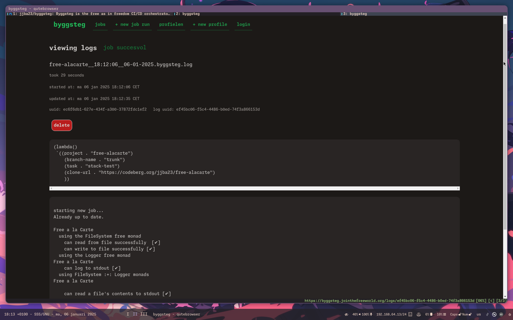

#+title: byggsteg
#+options: num:nil

/byggsteg/ means "build step" in the Norwegian language, and is a CI/CD orchestrator written in Guile Scheme.

byggsteg uses plain Guile, SXML, SQLite3 and some basic POSIX / UNIX utilities.

It is built with the mighty GNU Artanis web-framework.

** What is byggsteg ?

byggsteg is a free software project with the aim of developing a suite of functionalities to allow engineers to deliver software quicker and with less friction.

View my live instance of byggsteg here: https://byggsteg.jointhefreeworld.org

The aim of byggsteg is to release you from your dependency on proprietary systems like GitHub actions.
This allows you to create continuous integration and continuous delivery (CI & CD) pipelines in an easy way that are tailored to your needs and which you fully control.

My initial idea when developing byggsteg revolves around my projects, which are hosted on Codeberg and most of them deployed to my private VPS.

I don't mind having the software building and testing happening in the same machine as where I run the production workloads, since I am looking for supreme cost-efficiency, but it's highly recommended that you do separate these things, if you can afford it.

And thus, I set out to build a CI/CD system, that on command can:
- clone specified repo URL to an isolated folder for each branch (but caching by reusing same branch and doing ~git pull~)
- navigate to that directory and perform a system command a.k.a. job (for a Haskell project ~stack test~ or ~stack build~ or a combination of those)
- capture the log output of all steps and save it
- record job in progress, success or failure
- show dashboard with job statuses

byggsteg is a deploy-your-own type tool, but if enough community interest is shown a SaaS offering in freedom might be a really good thing.

byggsteg is built using the GNU Artanis web-framework. Make sure you install it before you proceed with using byggsteg.

Refer to the Artanis documentation: [[https://www.gnu.org/software/artanis/manual/manual.html][here]] .

Jobs and profiles are simple Guile Scheme code. byggsteg allows you to send code over the wire (HTTP) and save it too, in a thunk form, for example :
#+begin_src  scheme
  (lambda()
    `((project . "free-alacarte")
      (branch-name . "trunk")
      (task . "stack-test")
      (clone-url . "https://codeberg.org/jjba23/free-alacarte")))
#+end_src

Sending things in thunk form allows one to execute any code arbitrarily, inside the lambda expression. Be responsible and wary of who you give access to your byggsteg instance.

#+begin_src scheme
  (lambda()
    (define my-project-name "wikimusic-api")

    `((project . ,my-project-name)
      (branch-name . "trunk")
      (task . ("stack-build" "stack-test"))
      (clone-url unquote (format #f "https://codeberg.org/jjba23/~a" my-project-name))))
#+end_src

** Types of jobs

When defining a pipeline alist, the task field can be either a single step, or multiple.
You should either pass a string or a list of strings of job names.

~stack-test~ - Haskell project build and test with Stack + Hackage bundle.

~stack-build~ - Haskell project build with Stack + Hackage bundle.

~nix-build~ - Nix build (flake).

~byggsteg-version~ - Byggsteg pull and restart shepherd daemon itself.

~pull-and-restart~ - Git pull and restart wanted shepherd service.

~pull-and-deploy~ - Git pull and run a ~make deploy~.

~sbt-test~ - Scala project test with SBT.

As a fallback, if no other task matches are found, byggsteg will default to doing a ~make build~.

** Authentication

Byggsteg requires an authenticated session for performing administrative tasks such as creating/deleting jobs and profiles.

Upon starting a blank new byggsteg deployment you will have no users in the database.

Refer to [[file:db/migration/user_20250103093008.scm]] and edit the password field, or add more users. An important note is that currently authentication works by using the username (NOT email) and the passwords should NOT contain any special characters.

Then do a ~art migrate up user~ to add your users.

** Starting a job

After logging in, you can use the UI and visit ~/jobs/request~ or you can also invoke this via the REST API via Guile Scheme in URL encoded form data (~application/x-www-form-urlencoded~).

You could also do this for example from your favourite system programatically, or via cURL:

#+begin_src sh
  curl 'https://byggsteg.jointhefreeworld.org/api/v1/jobs/manage/submit' \
      -X POST -H 'Content-Type: application/x-www-form-urlencoded' \
      --data-urlencode 'username=myuser' \
      --data-urlencode 'password=mypassword' \
      --data-urlencode 'job-code=(lambda() `((project . "free-alacarte")(branch-name . "trunk")(task . "stack-test")(clone-url . "https://codeberg.org/jjba23/free-alacarte")))'

  #  {
  #    "log-id": "ce24da08-1833-4821-b7e3-e2bacaa79326",
  #    "human-id": "ZnJlZS1hbGFjYXJ0ZV9fMTQ6NTM6NTdfXzMwLTEyLTIwMjQuYnlnZ3N0ZWcubG9n"
  #  }
#+end_src

You can query for the job status via the UI or also via the REST API. You could implement a check to keep querying for job status until success or failure is true.

#+begin_src  shell
  curl 'http://localhost:50002/api/v1/logs/ce24da08-1833-4821-b7e3-e2bacaa79326'
  #
  # {
  #   "success": 1,
  #   "failure": 0,
  #   "in-progress": 0,
  #   "log-id": "ce24da08-1833-4821-b7e3-e2bacaa79326",  
  #   "human-id": "ZnJlZS1hbGFjYXJ0ZV9fMTQ6NTM6NTdfXzMwLTEyLTIwMjQuYnlnZ3N0ZWcubG9n",
  #   "log-data": "ZnJlZS1hbGFjYXJ0ZV9fMTQ6NTM6NTdfXzMwLTEyLTIwMjQuYnlnZ3N0ZWcubG9n.........."
  # }
#+end_src

** Using

You can run byggsteg server by calling ~art work~ from the root directory. Refer to the ~Makefile~ for more convenient commands and variations.

byggsteg exposes an HTML frontend (server-side-rendered SSR) and a REST API, and should be compatible with most UNIX like systems, but is best experiences with GNU Guix.

An example shepherd service for byggsteg could look like this:
#+begin_src scheme
    (use-modules (gnu)
                 (gnu services shepherd))

    ;; ...............

  (define (wolk-jjba-byggsteg-service config)
    (list (shepherd-service (documentation "Run byggsteg as a daemon")
                            (provision '(byggsteg))
                            (requirement '())
                            (start #~(make-forkexec-constructor '("make" "production-server")
                                      #:directory
                                      "/etc/byggsteg/job-clone/byggsteg/trunk"
                                      #:environment-variables
                                      (list
                                       "GUILE_LOAD_PATH=/run/current-system/profile/share/guile/site/3.0"
                                       "GUILE_DBD_PATH=/run/current-system/profile/lib"
                                       "C_INCLUDE_PATH=/run/current-system/profile/include"
                                       "GUILE_LOAD_COMPILED_PATH=/run/current-system/profile/lib/guile/3.0/site-ccache:/run/current-system/profile/share/guile/site/3.0"
                                       "LIBRARY_PATH=/run/current-system/profile/lib"
                                       "GIT_SSL_NO_VERIFY=1"
                                       "LANG=nl_NL.UTF-8"
                                       "PATH=/run/privileged/bin:/run/current-system/profile/bin:/run/current-system/profile/sbin")))
                            (stop #~(make-kill-destructor))
                            (auto-start? #t)
                            (respawn? #t))))

  (define wolk-jjba-byggsteg-service-type
    (service-type (name 'byggsteg)
                  (description "Run byggsteg as a daemon")
                  (extensions (list (service-extension
                                     shepherd-root-service-type
                                     wolk-jjba-byggsteg-service)))
                  (default-value '())))

    ;; then load it with (service byggsteg-service-type)
#+end_src

** Licensing

byggsteg is licensed under the GNU GPL v3 License or newer.

** Performance

byggsteg is quite a performant implementation of a CI/CD system and the numbers might surprise you for a Scheme only full stack implementation (SXML + SQLite + more).

[[file:docs/BENCHMARKS.org][See some of byggsteg's benchmarks here]]

** Code owners

The project's main branch is ~trunk~. Find a list of roles and people involved in the project.

*** BDFL (Benevolent Dictator For Life)
@jjba23 - Josep Bigorra <jjbigorra@gmail.com>

Only BDFL can merge PRs.
Only BDFL is allowed to push directly to ~trunk~ in case a quick fix is needed.

*** MFL (Maintainer For Life)
@NalaGinrut - Roy Mu <NalaGinrut@hardenedlinux.org>

MFL can ascend to BDFL after extensive productive collaboration.
MFL has write permissions to all branches (except trunk) and can open PRs.

*** Other contributors
Other contributors must fork byggsteg and create a pull request to contribute back.
After productive collaboration other kinds of roles can be added and assigned.

** Translation effort

byggsteg is a community driven effort and as such, can use your help in translating to several different languages.

*** English language (en_US)
100% translated

*** Dutch language (nl_NL)
100% translated

** Ongoing efforts

**** WIP Feature parity (bring all functionalities to REST JSON)

** Project backlog

**** TODO job-code that users send to byggsteg should not be ~eval~ directly but rather in a sandbox, using ~(ice-9 sandbox)~ capabilities.

**** TODO add comprehensive unit and integration tests

**** TODO Add notifications upon success or errors as balloons/banners via URL params

**** TODO Make certain values more configurable, like worker sleep time, etc.

**** TODO Be explicit about other projects/libraries used to make byggsteg and their licenses

**** TODO Consider using gettext for internationalization and localization, or improve existing setup, or wait for Artanis to provide i18n

**** TODO Add REPL interface via website, to allow hot-modifications

** ✅ Work done

**** DONE Migrate to SQLite
CLOSED: [2024-12-31 di 15:19]

**** DONE Add correct copyright and license header to all source code files
CLOSED: [2024-12-31 di 15:19]

**** DONE Hot reload server
CLOSED: [2024-12-30 ma 14:55]

**** DONE Move to using base64 for URLs and payloads instead of base16
CLOSED: [2024-12-30 ma 14:55]

**** DONE Allow user to send Guile Scheme over the wire and define his/her own pipeline in a ~progn~ fashion.
CLOSED: [2024-10-03 do 13:24]

**** DONE Concurrency primitives and usage
CLOSED: [2024-10-01 di 00:23]

**** DONE Split codebase into separate modules
CLOSED: [2024-09-28 za 12:17]

**** DONE Implement basic internationalization
CLOSED: [2024-10-05 za 14:34]

**** DONE Migration to GNU Artanis
CLOSED: [2024-12-02 ma 14:24]

**** DONE Improve JSON support
CLOSED: [2024-12-02 ma 17:07]
