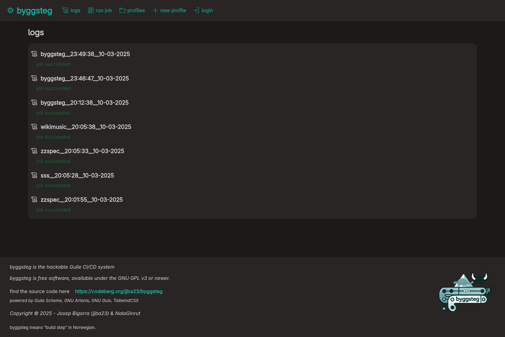

#+title: byggsteg
#+options: num:nil

[[https://jointhefreeworld.org/static-assets/badges/GNU-Guix-c48702.png]] [[https://jointhefreeworld.org/static-assets/badges/Scheme-Guile-d0730f.png]]

byggsteg is a CI/CD orchestrator written in Lisp (Guile Scheme), leverages SXML, SQLite3, some POSIX / UNIX utilities, and the mighty GNU Artanis web-framework.

* What is byggsteg ?

byggsteg is a free software project with the aim of developing a suite of functionalities to allow engineers to deliver software quicker and with less friction.

View my live instance of byggsteg here: https://byggsteg.jointhefreeworld.org

The aim of byggsteg is to release you from your dependency on proprietary systems like GitHub actions.
This allows you to create continuous integration and continuous delivery (CI & CD) pipelines in an easy way that are tailored to your needs and which you fully control.

Easily deploy stuff, for example to your private VPS, self-hosting or to cloud.
/byggsteg/ means "build step" in the Norwegian language.

I don't mind having the software building and testing happening in the same machine as where I run the production workloads, since I am looking for supreme cost-efficiency, but it's highly recommended that you do separate these things, if you can afford it.

[[https://jointhefreeworld.org/static-assets/byggsteg/logo-small.png]]

----------

* Licensing

byggsteg is licensed under the GNU GPL v3 License or newer and is  built using the GNU Artanis web-framework.

------

---------

* Jobs and profiles

Jobs are simple Lisp (Guile Scheme) code. Profiles are just saved jobs.

byggsteg allows you to send code over the wire (HTTP) and save it too, in a thunk form, for example :
#+begin_src  scheme
  (lambda()
    `((project . "free-alacarte")
      (branch-name . "trunk")
      (task . "stack-test")
      (clone-url . "https://codeberg.org/jjba23/free-alacarte")))
#+end_src

Sending things in thunk form allows one to execute any code arbitrarily, inside the lambda expression. Be responsible and wary of who you give access to your byggsteg instance.

TODO: A sandbox where pipeline expressions get run.

#+begin_src scheme
  (lambda()
    (define my-project-name "wikimusic-api")

    `((project . ,my-project-name)
      (branch-name . "trunk")
      (task . ("stack-build" "stack-test"))
      (clone-url unquote (format #f "https://codeberg.org/jjba23/~a" my-project-name))))
#+end_src

-----

* Byggsteg Manuals

I strive to provide proper and extensive documentation on Byggsteg, available at your convenience.

- Org format [[file:docs/manual/en-GB.org]]

[[https://jointhefreeworld.org/static-assets/byggsteg/img/logo-small.jpg]]

--------

* Code of conduct

This project adheres to the jointhefreeworld code of conduct. Find it here:

https://jointhefreeworld.org/blog/articles/personal/jointhefreeworld-code-of-conduct/index.html

In summary, we foster an inclusive, respectful, and cooperative environment for all contributors and users of this free software project. Inspired by the ideals of the GNU Project, we strive to uphold freedom, equality, and community as guiding principles. We believe that collaboration in a community of mutual respect is essential to creating excellent free software.

--------

* Licensing

byggsteg is licensed under the GNU GPL v3 License or newer.

